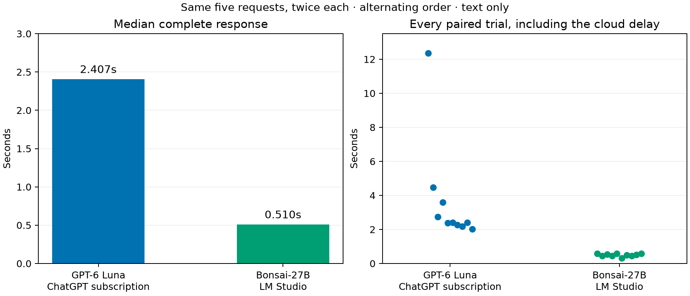
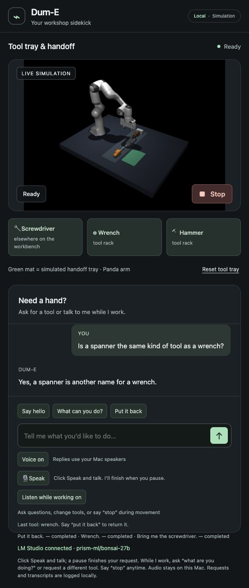

# Bonsai conversation backend — October 12, 2026

## Current-session recheck before load tuning

The running workbench still selects `prism-ml/bonsai-27b` at the user's existing
LM Studio endpoint. LM Studio's loaded-model inventory places this instance on
the linked workstation. A fresh read-only pass of the same 15 dialogue cases
records 15/15 correct action/object decisions, a 2.061-second median and a
2.891-second sample p95/maximum. The simulator stays Ready with its job unchanged;
this check does not move the arm. All 20 focused LM Studio/cache tests pass.
Raw replies and timings are retained in
`runs/bonsai-current-recheck-20261012/summary.json`.

This current measurement is slower than the earlier study below. The cause has
not been isolated, and the earlier 0.510-second comparison should not be treated
as a guarantee of present response time. These clocks exclude live speech capture,
speech recognition, audible reply onset and physical motion. The selected vision
model remains a separate component; no model reload or device preference change
was made for this recheck.

The subsequent [load-configuration experiment](bonsai-load-tuning-audit.md)
reduces this same 15-case median to 0.686 seconds with explicit GPU offload and
one prediction slot. That configuration is now retained in the running session;
the slower baseline above remains part of the record.

Bonsai is selected in the running workbench through LM Studio/LM Link. The
matched text comparison measures a 0.510-second median complete response,
against 2.407 seconds for GPT-6 Luna. This improves conversation and general
request interpretation; the existing checked physical controller remains in use.



## Model identity and configuration

The user's server exposes `prism-ml/bonsai-27b` as its loaded instance. Metadata
reports GGUF `Q1_0`, 27B parameters, 4,734,614,604 file bytes and an 8,192-token
loaded context. The 27B label is parameter count, not memory in gigabytes. The
publisher describes a natively low-bit model; the actual server's reported file
size is recorded instead of substituting an advertised size.
[Publisher model card](https://huggingface.co/prism-ml/Bonsai-27B-gguf).

The user says the RTX 5090 workstation hosts it, and previously confirmed that
device is preferred in LM Link. The API does not identify the physical inference
device; no GPU utilization, driver or kernel claim is inferred from a successful
response. The returned model identifier matches the configured identifier. This
does not verify the weights by cryptographic hash. The API advertises vision
capability, but this experiment sends text and simulator positions, not images.

Model/provider selection is now explicit at launch:

```sh
# From the lab root:
uv run --locked --extra assistant --extra dume dume-sim \
  --language-backend lmstudio --model prism-ml/bonsai-27b

# From Dum-E/extensions/workbench:
uv run --locked dume-sim --language-backend lmstudio --model prism-ml/bonsai-27b
```

`--lmstudio-url` selects a different authorized server; localhost port 1234 remains
the default. `--model` accepts the model ID exposed by that server, without a
Bonsai or Qwen branch in the interpreter. LM Studio now requires a model selection
rather than guessing Qwen. Environment variables remain supported:
`WORKBENCH_LANGUAGE_BACKEND`, `WORKBENCH_LMSTUDIO_MODEL`, `WORKBENCH_LMSTUDIO_URL`.
Authentication uses the existing optional `WORKBENCH_LMSTUDIO_TOKEN`; credentials
must not be embedded in URLs. Configuration changes apply to the launcher and its
children, not the user's machine-wide settings.

Mac MLX uses `--language-backend mlx --model /absolute/model/folder` or the existing
cached default. The qualified subscription option remains `--language-backend
codex` with GPT-6 Luna; other Codex model names are explicitly rejected. Models
need compatible JSON-schema output and must pass a real read-only startup call.
Changing an ID does not establish the new model's semantic correctness. The
frozen qualification scripts are retained for evaluating other choices.

An existing native simulator is reused only when its scene, provider, selected
model and LM Studio endpoint match. A stale MLX folder cannot override the
LM Studio selection. A different or unknown endpoint is rejected rather than
silently keeping another server. Reported model substitution, failed HTTP calls,
timeouts, malformed/truncated JSON and incomplete streams do not become intents;
there is no automatic retry, model swap or paid API fallback. Timeouts are reported
as an explicit request failure; the following request can recover without queued
motion. [LM Studio model metadata](https://lmstudio.ai/docs/developer/rest/list).

## Frozen comparison and correction

The first candidate passes all 129 action/object trials across the unchanged 43
cases, but its abilities reply omits simulation disclosure in all three repeats.
That factual-quality failure is retained. A single shared closing instruction
requires an abilities answer to begin “In simulation,” and describe bringing/
returning tools and conversation. No model-specific parser or factual judge was
changed. Three direct probes then disclose the correct scope.

The final candidate repeats the same 43 frozen cases three times: **129/129**
action/object checks pass. Lead review of all 30 factual replies meets their
existing criteria: simulation/hardware, absent webcam access, no real feelings,
tool knowledge, supplied history and no invented success or laptop repair.
Some answers still repeat capabilities unnecessarily, notably the feelings
response. This is a conversational-style limitation, not a claim of perfect
personality or a convincing human demonstration.

| Complete text measurement | Median | Sample p95 | Maximum |
|---|---:|---:|---:|
| Bonsai final frozen study, 129 trials | 0.560 s | 0.760 s | 1.149 s |
| Bonsai matched paired sample, 10 calls | 0.510 s | 0.592 s | 0.592 s |
| Luna matched paired sample, 10 calls | 2.407 s | 12.360 s | 12.360 s |

The paired test alternates call order for five identical requests repeated twice,
using the same Dum-E instructions, intent schema, history and observations. Both
backends have zero intent errors. The median is 78.8% lower with Bonsai in this
sample; the retained Luna outlier must not be dropped. Ten calls per path do not
establish population tail latency. Calls are sequential, with no concurrent
inference from this benchmark; other workstation contention is not measured.
Times exclude speech capture, VAD, ASR, audible onset, motion and loading weights.
The isolated final Bonsai simulator prepared in 802 ms, including a 762 ms
read-only API warmup; the model was already loaded. This is not a cold model-load
measurement. Full rows, responses, fixture hashes and warmups are retained.

## Interaction and physics

The primary assistant runs at `http://127.0.0.1:8766/`, native simulator 8765 and
original Dum-E MCP 8001. It displays the selected Bonsai ID. Text, recent dialogue
and simulator observations use the configured LM Studio server; capture, Silero,
Whisper, Mac speech and MuJoCo stay on the Mac. No idle microphone access, model
download, preferred-device change, CUDA installation or paid service was added.

The actual main task bus passes three 32-second wall-clock paused holds and
verified continuations: screwdriver resume to handoff 8.00 mm, return 11.64 mm;
wrench return from hold 6.09 mm; hammer resume 8.75 mm, return 13.90 mm. Stop
POST replies take 3.0–4.4 ms; observing Stopped/no busy task takes 66–72 ms.
These poll-bounded typed endpoints are not spoken Stop or zero-velocity settling
measurements. Joint drift, grip retention and placement limits remain unchanged.

A real pending Bonsai conversation returns `superseded` after Stop with no task,
observed within 308 ms. The next model question works while the grip stays closed.
LM Studio computation may continue until its response or timeout; this adapter
discards the cancelled reply locally and does not claim remote compute abortion.

The saved semantic speech “I need something for turning screws” is transcribed
correctly by actual local Whisper, then reaches the model route and physically
delivers a screwdriver: 9.48 mm error and 206.8 mm observed lift. Contextual return
passes with 11.72 mm error. Recognition upload-to-response is 152 ms; native
request-to-decision is 736 ms. Pickup begins at 2,740 ms, including existing
empty-arm positioning, and completion at 18,180 ms. These separate stage clocks
are not added together or advertised as end-of-human-speech latency. This test
does not exercise live capture, browser endpointing or audible acknowledgment.

Full regression suites pass: **234 lab / 215 fork tests**, including selection,
endpoint matching, reported substitution refusal, timeout recovery and existing
voice/physics guards, followed by an explicit local-folder reuse guard. All 34
focused transport/API checks pass in each checkout after that addition. All 46
protected upstream source hashes match.

The existing saved-speech integration also passes: question during lift without
changing the task/grip, screwdriver-to-wrench change with verified old-tool
return, Stop/resume preserving both steps, contextual return, hammer-request
withdrawal and clarification across completion. Change placement errors are
6.98 mm screwdriver-to-rack and 10.03 mm wrench-to-handoff; withdrawn hammer
returns with 10.28 mm error. An actual Bonsai joke response during the hammer
lift takes 850 ms through the bridge and leaves its task running. Saved-speech
upload-to-ASR-plus-dispatch ranges 120–234 ms for six clips; this excludes live
recording and end-of-speech detection. Browser outcomes are added to the evidence.

In the actual browser, the abilities button returns the existing fast familiar
answer; it is not a Bonsai inference timing. The separate typed spanner/wrench
question goes through the model route, returns the configured Bonsai ID and a
correct informational answer without starting a physical task. The final tab is
Ready with all tools on the rack, Voice and motion-time listening ON, and the
microphone idle.



Before the model switch, the older Luna session had an idle screwdriver position
72.67 mm from its recorded successful rack return, with no new task. The snapshot
is preserved; we have not established the cause or exact drift time. Successful
placement at task completion does not prove long-idle stability. This remaining
physics issue is independent of selecting Bonsai and is not silently counted as
fixed. The full workbench goal remains active: camera-informed public operation,
actual pretrained arm policy, long-idle consistency and human live/noise evidence
remain unfinished.

## Reproduce the checks

Use fresh output folders in the existing project environment:

```sh
python scripts/benchmark_dialogue.py runs/new-bonsai-dialogue --repeat 3
python scripts/benchmark_language_backends.py runs/new-paired \
  --lmstudio-model prism-ml/bonsai-27b
python scripts/verify_hold_luna.py runs/new-bonsai-hold \
  --expected-model prism-ml/bonsai-27b
python scripts/verify_voice_delivery.py --output runs/new-semantic-voice \
  --message 'I need something for turning screws.' \
  --expect-model-interpretation --return-after-delivery
python scripts/verify_interaction.py runs/new-bonsai-interaction
```

The main app must be idle before motion tests; turn Voice and Listen while working
off for automated checks, and restore them afterward. No microphone is opened by
these scripts. The text qualifier defaults to native port 8765; specify another
`--url` for an isolated candidate. Context, multi-tool and factual suites use the
three additional `fixtures/dialogue_*_cases.json` files documented in the evidence.

[Evidence and replies](bonsai-evidence.json). Raw synthetic traces remain local in
`runs/bonsai-*`, with runtime logs under the fork extension's
`runs/bonsai-main-001`. Models are interchangeable components; qualification,
honest scene information and verified action outcomes are shared requirements.
