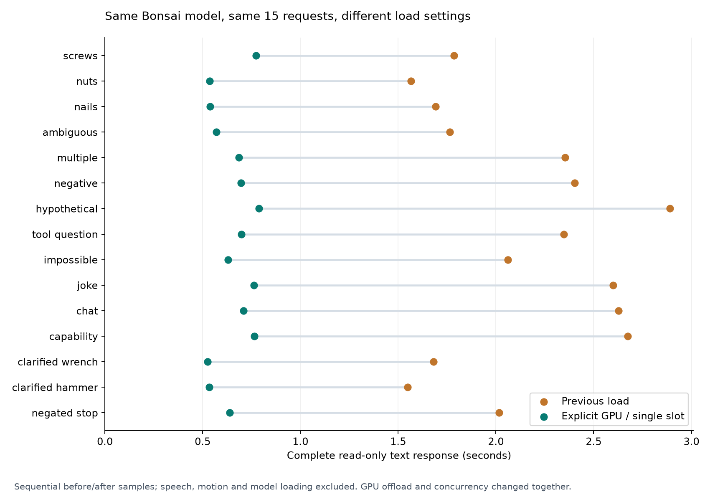
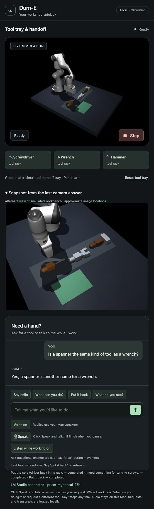

# Faster Bonsai inference — October 12, 2026

The existing linked workstation now serves Bonsai with explicit maximum GPU
offload and one prediction slot. The unchanged 15-case text benchmark improves
from **2.061 s to 0.686 s median**, with zero action/object errors in both samples.
No application prompt, command parser, physical controller or dependency changed.



The baseline's median time before the first content token was 899 ms; the
candidate's was 368 ms. Median time from that token to complete interpretation
was 1,165 ms versus 271 ms. These separate medians must not be added to calculate
a median total. HTTP/native overhead in the baseline was approximately 3 ms;
inference was the dominant delay. Both load settings changed together, so this
experiment does not establish which setting caused how much of the improvement.
GPU offload is requested explicitly, not verified by driver/kernel telemetry.

| Matched sequential text sample | Cases | Errors | Median | Sample p95 / max |
|---|---:|---:|---:|---:|
| Previous load, four slots | 15 | 0 | 2.061 s | 2.891 s |
| Explicit GPU offload, one slot | 15 | 0 | 0.686 s | 0.788 s |

The median is 66.7% lower in this before/after sample. Requests use the identical
fixture SHA, scene context and existing instruction/schema path. This is a
sequential study, not an alternating controlled comparison; external workstation
activity was not measured. Timings include read-only HTTP response completion,
and exclude speech capture, VAD, transcription, audible reply onset, motion and
weight loading. The first prediction after the explicit load was 773 ms; LM
Studio reported 4.27 s for loading weights. These are separate clocks.

## Qualification and the actual assistant

All four unchanged dialogue suites, repeated three times, pass **129/129**
action/object checks. Overall complete text median is 662 ms, sample p95 793 ms
and maximum 901 ms. Lead review of the 30 factual replies passes the existing
truthfulness/knowledge/history criteria. Feelings replies still repeat the
capability list unnecessarily; style is not declared finished.

The actual main simulator accepts synthesized saved speech “I need something for
turning screws.” Local Whisper transcribes it, Bonsai selects the screwdriver,
and the existing Dum-E task stack physically retrieves and returns it. Observed
lift is 208.4 mm, handoff error 9.69 mm, and return error 12.70 mm; the original
80 mm lift and 35 mm placement gates remain intact. Recognition upload-to-reply
takes 145 ms. Native request-to-decision is 572 ms; pickup starts at 2,634 ms and
task completes at 17,806 ms, including arm positioning and physical travel. These
stage clocks do not establish end-of-human-speech or audible acknowledgment time.
Silence still produces no task. No microphone or speaker is used by this probe.

The separate Gemma camera model remains on the same linked workstation. A fresh
optical request identifies all three visible tools, using the bounded alternate
view, in 2.617 s. It still exceeds the camera's 2 s target in this case; this
language-load change does not solve that camera tail. Camera coordinates remain
conversational estimates and do not set the arm's grasp targets.

Three read-only replies after approximately 12 s idle complete in 815, 839 and
1,055 ms. All are correct, with the native job unchanged. This small check does
not prove hours-idle, sleep/wake, GPU contention or real-room performance. Existing
LM Studio/cache regressions pass 20/20. Stop/grip physics have not changed; this
turn does not claim a fresh spoken Stop/32 s hold qualification.

## Reproduce or switch models

The actual browser answers the spanner/wrench question without starting a task.
The final app is Ready, all three tools are on the rack, Voice and Listen while
working are ON, and the microphone is idle.



Use LM Studio's supported [load controls](https://lmstudio.ai/docs/cli/local-models/load).
With the assistant idle, unload only the intended instance, then load it:

```sh
lms unload prism-ml/bonsai-27b
lms load prism-ml/bonsai-27b --gpu max --parallel 1 \
  --context-length 8192 --identifier prism-ml/bonsai-27b --yes
lms ps --json
```

This selected the user's existing preferred linked workstation. Verify placement
with `lms ps` after loading; ambiguous copies of a model require choosing the
correct device. Only Bonsai was reloaded. Vision weights, preferred-device
settings and other software were left intact. No TTL was specified for this
explicit load: the instance remains resident until unloaded or device/application
shutdown. A future reload with default settings can restore the slower behavior;
the assistant does not silently change another person's server configuration.

The single slot fits the current serialized language interpreter. Other clients
sharing this instance may queue instead of generating in parallel. Keep context
at 8,192 tokens; context/history/schema limits are unchanged. Maximum offload
is not a universal recommendation for larger models or different hardware.

Model choice remains `--language-backend lmstudio --model MODEL_ID`, with
`--lmstudio-url` for an authorized endpoint. Different models must support the
existing output contract and pass these same qualification cases. No Bonsai-only
language parser or automatic provider/model fallback was introduced.

Run the checks from the lab root with fresh output directories:

```sh
uv run --locked --extra assistant --extra dume python \
  scripts/benchmark_dialogue.py runs/new-load-check --repeat 1
uv run --locked --extra assistant --extra dume python \
  scripts/benchmark_idle_model.py runs/new-idle-check --idle-seconds 12 --repeat 3
uv run --locked python scripts/plot_lmstudio_tuning.py \
  docs/bonsai-load-tuning-evidence.json /tmp/bonsai-load-tuning.png
```

The fork's lightweight environment can run text checks. Plot regeneration uses
the lab environment, which already includes Matplotlib. For rollback, unload
only Bonsai and reload its same identifier/context with default GPU settings and
`--parallel 4`; no code rollback is required. Raw local evidence is under
`runs/bonsai-load-tuning-20261012`, with the slower baseline in
`runs/bonsai-current-recheck-20261012`. [Recorded results and replies](bonsai-load-tuning-evidence.json).
Published evidence contains curated measurements and reviewed synthetic replies;
generated audio, provider traces and machine inventory stay local.

This is progress toward responsiveness. Camera-driven manipulation, an actual
pretrained arm policy, live-room/acoustic response measurements and the user's
convincing live demonstration remain unfinished. The overall goal remains active.
