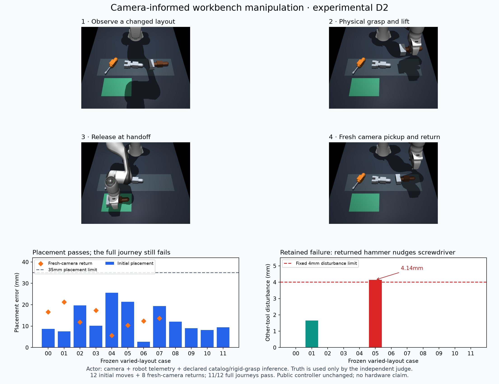

# Camera-informed contact manipulation — experimental D2

The camera now guides actual contact-based pickup, delivery and return in a
separate simulator experiment. All 12 frozen varied-layout initial moves meet
the unchanged lift/placement checks. The fuller journey passes 11/12 cases:
one returned hammer nudges its neighboring screwdriver by 4.14mm, beyond the
fixed 4mm disturbance limit. **The full journey gate fails; this controller is
not promoted into the public assistant.** The accepted voice/controller workflow
continues unchanged. The complete workbench goal remains active.

Seeing where a tool starts is only part of the problem. Once the arm grips it,
the tool can settle or rotate inside the fingers. A useful world model must
account for those changes rather than assume a perfectly rigid grasp.

## Observation and actuation boundary

`CameraDelivery` receives two narrow ports: a timestamped RGB/depth camera and
a robot interface providing joint positions, forward-kinematics TCP pose,
encoder finger gap, gripper command and clock. The actor has no simulator model,
object positions, segmentation IDs, true carried offsets or support-height API.
The native backend retains the measured doubled gripper gains, damping scaling
and original force caps. No tool is welded, attached or teleported during a task.

Color pixels provide identity seeds; connected coplanar depth provides the
handle face geometry. A minimum-area rectangle scan estimates position and
yaw modulo 180 degrees. This replaces perspective-sensitive PCA axes and
retains specular edge pixels that lost their material color. Known 44x56mm
horizontal handle geometry and material colors remain catalog assumptions.
This is not arbitrary-tool recognition or a camera VLA model.

Before approach and again before lowering, the actor captures and localizes the
target. Missing, ambiguous, invalid, stale or weak fits cause refusal, with no
rack-position or true-pose fallback. Provisional motion fit minimum is 0.8;
`fit_score` is not a probability. Maximum age is 0.25 seconds on the same clock
as robot telemetry (MuJoCo simulation time here). The camera port supplies the
capture timestamp; an actual cached-frame test rejects stale input before motion.

Grasp presence uses a closed command with measured finger gap between 15 and
70mm. This is a simulated tactile proxy, not proof of identity or real contact
sensing. Carry pose is explicitly **inferred** from the last camera pose and a
rigid-grasp transform. Placement clearance uses a declared primitive-tool catalog
and estimated orientation, conservatively considering both possible handle signs.
It never queries true geometry or rotation. Independent truth judging happens
outside the actor. The actor only reports `released_unverified`, never success.

Stop retains the gripper command and holds current joints. Held-tool resume
rebuilds interpolation from current joints; redirect uses the camera-recorded
original rack position. Pre-grasp or uncertain-grip resume currently refuses and
requests a rescan. Held-tool slip, arbitrary tilt and extended pauses are not
visually tracked. These gaps must be handled before integration replaces existing
all-phase recovery. Automatic speech, voice Stop and general conversation are
unchanged and are not exercised by this offline camera verifier.

## Fixed judges and retained failures

`camera_delivery_cases.json` was frozen before the first actor run: 3 straight
pilot cases plus 12 independent varied cases, with shuffled tool slots, x/y/yaw
variation and lighting changes. SHA256:
`acb1b93171a78e0b1589f98a88187a077562749896a6985f7cd50ee359335e72`.
The physical limits remain 80mm lift, 35mm placement error, resting height below
40mm, speed below 30mm/s and other-tool disturbance below 4mm. Stop probes hold
for 608ms, retain the grip and require joint drift below 0.03rad. Full-journey
acceptance is provisionally 95%; no failed criterion was weakened.

The first pilot refused all three tools: visible edges were classified or fitted
as incomplete. A rectangle-only revision still refused all three. After diagnosing
actual color/depth pixels, connected depth-plane geometry enables screwdriver
and wrench pickup; the straight hammer remains a conservative refusal with
fit 0.768. This is retained as a support limitation rather than overridden.
No further actor or detector tuning followed held-out results.

| Independent physical check | Result |
| --- | --- |
| Initial varied-layout moves | 12/12 lifted and resting in target |
| Initial move placement error | 2.65–25.64mm |
| Held-tool interruption | 8/8 retain grip; maximum joint drift 0.00572rad |
| Resume to handoff | 4/4 physically placed |
| Redirect a held tool to its original rack | 4/4 physically placed |
| Fresh-camera return after completed handoff | 8/8 physically placed |
| Full journey, including other-tool disturbance | 11/12; fixed gate fails |
| Retained disturbance failure | Hammer return, heldout-05; screwdriver moves 4.14mm |

The original first verifier summarized only lift/placement. A stronger inspection
found that it had omitted secondary-return disturbance from the combined verdict.
The verifier now checks that disturbance across both moves and records return
height/speed/lift explicitly. It also avoids counting a redundant regrasp at the
rack as a handoff return. Earlier evidence is retained; final evidence reflects
all criteria. The renderer's macOS depth-precision warning remains recorded.

A separate evaluator-only diagnostic measures about 10.4mm error between the
rigid-grasp estimate and the actual held hammer before descent. The screwdriver
is disturbed during descent/release. This supports a carry-estimation limitation;
it does not prove a precise causal decomposition of slip, servo error and contact.
The fixed disturbance failure prevents default promotion even though target
placement passes. Next address held-tool drift and placement interaction through
observations or a validated dynamics estimate, then rerun all existing judges and
additional untouched layouts.

## Perception accuracy and responsiveness

The unchanged D1 dataset/judges also pass with the new geometric fitter: all
72 held-out clear tools observed, position p95 0.257mm and maximum 0.404mm;
all 12 obscured target handles withheld, no identity confusions. The original
5.29mm pilot outlier becomes 0.10mm; pilot maximum is now 0.529mm. Original
results remain archived in `camera-perception-evidence.json` at D1 commit d6c5b1f.
The extra geometric work costs processing time; it is not a speed improvement.
Serialized capture/pose timing is 59.7ms median / 64.8ms p95 over 30 samples;
scene preparation takes 297ms and the first sample 94.8ms. The full regression
results are preserved in `camera-delivery-evidence.json`. Earlier timing probes with concurrent physics
or regression work are separately labeled, not treated as clean comparisons.
These measurements exclude IPC, live motion, disk IO, speech and audible onset.

Independent tests deny access to `observe` and `tool_support_height` during
actual camera-guided movement for all three tools. Separate evaluators still
verify lift and placement. Additional tests cover actual empty-gripper failure,
missing depth without any simulator step, cached timestamps, NaN confidence,
invalid pose, ambiguous/weak observations and an independently measured yaw.
Fresh full suites pass:158 lab tests and139 independently exported fork tests;
Ruff and formatting pass. All46 pinned upstream source hashes remain protected. No dependencies, models,
webcam access, microphone access or paid services were added.



## Reproduce

From the lab or `Dum-E/extensions/workbench`, use new output directories:

```sh
uv run --locked python scripts/verify_camera_delivery.py runs/camera-pilot-new --fixture fixtures/camera_delivery_cases.json
uv run --locked python scripts/verify_camera_delivery.py runs/camera-journeys-new --fixture fixtures/camera_delivery_cases.json --split heldout --return-after-delivery
uv run --locked pytest -q tests/test_camera_control.py tests/test_perception.py
```

Expect the documented conservative pilot refusal and the failing full-journey
disturbance gate on this version; do not treat actor release or green unit tests
as proof that all journeys are accepted. New synthetic frames/results remain in
ignored local runs. Public evidence contains synthetic data only. The figure can
be rebuilt in the lab's locked Matplotlib environment with
`scripts/plot_camera_delivery.py`; plotting remains optional in the fork.

Next: improve held-tool pose/clearance, preserve the existing voice and recovery
contract, expose truthful observation provenance in the app only after integration,
and demonstrate the combined user journey. Useful learned-model improvements,
acoustic/noise testing, hardware adapter/plan and the human live demonstration
remain required. Simulation establishes no hardware readiness.
