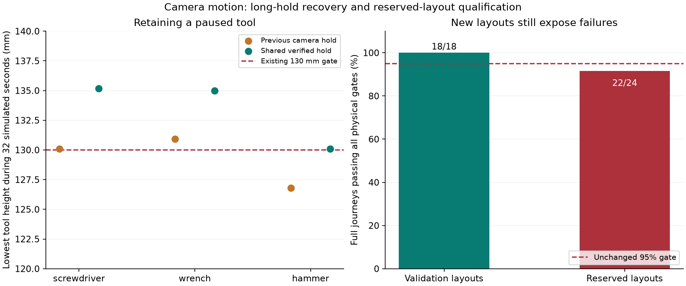

# Camera motion requalification — October 12, 2026

The experimental camera adapter now reuses the working assistant's verified
gravity-compensated hold. All six long-hold/continuation cases pass, and the
existing optional camera profile passes all 18 validation journeys under the
current tool contacts. Its first reserved-layout evaluation passes **22/24**,
below the unchanged **95% full-journey gate**. Camera motion is not promoted to
the public assistant. The working Bonsai voice/control and Gemma camera-answer
session remain available.



## Reuse and the hold correction

The conventional profile first requalifies at 17/18: validation-016's wrench
redirect lands 36.667 mm from its rack target, outside the 35 mm limit. The
existing optional profile enables straight Cartesian lifts, measured grasp
centering, bounded IK recovery, verified motion and camera/catalog handoff
clearance. It previously passed 18/18 under older contacts, and now passes 18/18
with the current `tool_contacts_v2` physics. No new solver, motion recipe, grip
gain, friction, force limit or trained model is introduced.

The adapter's previous `hold()` copied measured joint angles directly into servo
targets, bypassing the existing `Workbench.hold_joints()` method. In the frozen
32-simulation-second early-lift protocol, it passes 4/6 journeys: the hammer sags
to 126.80 mm, below the existing 130 mm retained-height requirement. The shared
method changes arm targets to balance static gravity, retaining the grip command.
It does not set body poses/velocities, add object welds, or freeze physics.

The actual revised adapter passes **6/6**, covering screwdriver/wrench/hammer and
resume/return. Minimum height is 130.09 mm in the lowest case; that is a narrow
margin, not broad robustness. Maximum joint drift is 0.00955 rad and held-tool
translation 2.05 mm, within the original 0.02 rad / 10 mm gates. Every continuation
physically releases at the requested tray/rack; largest placement error is
15.79 mm. Unrelated-tool center displacement remains below 4 mm throughout.
These are offline simulation clocks, not 32 wall-clock seconds or spoken Stop.

The final shared-hold profile then repeats validation at **18/18**, including
12 fresh-camera returns. It was frozen, with source hashes and the unchanged
fixture hash, before the 24 reserved cases were evaluated. The short-hold and
long-hold protocols remain distinct; no threshold or timing boundary was lowered.

## What the reserved layouts exposed

All 24 cases ran; **22 complete journeys pass**, with 17 fresh-camera returns.
Passed actors and return actors report `released_unverified`; separate body-state
judges establish physical placement. The two failures remain failures:

- **test-009, screwdriver delivery:** the geometric fit scores 0.7980, below the
  unchanged 0.8 acceptance gate. The actor refuses before moving. This is a
  coverage failure, not a delivered tool or a calibrated 79.8% probability.
- **test-016, wrench redirect:** the encoder grip indication disappears during
  the lift, before the planned interruption is reached. The actor holds the arm
  and reports failure. At the recorded endpoint, the tool is 148 mm high and
  moving at 0.876 m/s; it has not met resting placement requirements. A nearby
  XY coordinate is insufficient evidence of a successful return.

The 91.7% observed success rate fails our 95% gate; at least 23/24 would be needed.
No retry tuned to these test layouts, weaker fit gate, wider placement tolerance
or selected subset is substituted for the result. These cases are now evaluated
test evidence; they cannot be presented as fresh unseen data for a later tuned
controller. The independent metric audit reconstructs every recorded verdict
from lift, distance, height, speed, disturbance, hold and return measurements.

The pose detector still knows the synthetic tools' primitive geometry/colors.
While carrying, body pose is inferred from a rigid-grasp approximation and robot
kinematics. This is neither general tool recognition nor a pretrained VLA policy.
Body-center disturbance is sampled every 32 ms; sub-frame collisions, tool-tip
motion and rotation are not separately qualified.

## Readiness and next work

The camera actor's current `resume()` requires a confirmed held handle. A separate
early-/late-phase probe verifies that it refuses continuation during approach,
grasping and withdrawal after a 32-simulation-second pause on the validation-000
screwdriver layout. Before public
integration, the task layer must handle those stages, fresh perception after
interruption, release verification, and task changes. The six held-tool checks
do not establish all-phase recovery.

The next major control experiment remains the prepared pretrained
[OpenPi/LIBERO integration](../integrations/openpi-client/README.md), in its
supported workstation runtime, with checkpoint/runtime/closed-loop evidence.
LM Link currently serves our language/vision models; it does not expose a Linux
robot-policy simulator or workstation shell to this chat. The user's WSL/Ubuntu
availability question is pending. No actual pretrained policy or LIBERO rollout
is claimed. Preserve these failures and compare future policies on full journeys;
do not resume custom IK/physics sweeps as a substitute for that integration.

## Reproduce

From the lab root or the exported workbench extension, use fresh output folders:

```sh
uv run --locked python scripts/verify_camera_pause.py runs/new-camera-hold \
  --hold-profile shared
# Reproduce the previous position-only hold without rolling back source:
uv run --locked python scripts/verify_camera_pause.py runs/new-old-hold \
  --hold-profile position
uv run --locked python scripts/verify_camera_delivery.py runs/new-camera-validation \
  --fixture fixtures/release_model_cases.json --split validation \
  --recover-ik --verify-motion --release-fallback --linear-lifts --center-grasp \
  --safe-handoff --return-after-delivery
```

The hold verifier preserves failed rows and exits nonzero if the protocol fails.
The delivery script's structured `passed` field must be inspected; its process
exit alone is not a qualification. `--release-fallback` is retained from the
existing profile but has no learned-model effect here: no carry/release weights
are loaded. Plot regeneration uses the lab environment's existing Matplotlib.

Evidence is [curated measurements](camera-motion-requalification-evidence.json).
Full regression suites pass **269 lab / 250 exported fork tests**, including six
new physics/continuation tests with privileged tool-state methods denied. All
46 protected upstream source hashes match. Ruff/format checks pass for changed
Python files. The original assistant's physical controller remains in use.
Raw images/observations/logs remain in local ignored `runs/camera-*` folders.
Full goal remains active: public camera-derived motion, actual pretrained arm
control, live acoustic/audible response and a convincing human demonstration
are incomplete. Simulation qualification does not establish hardware readiness.
