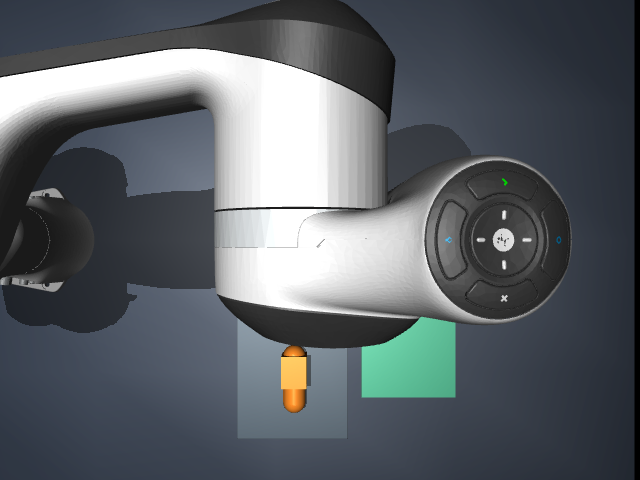
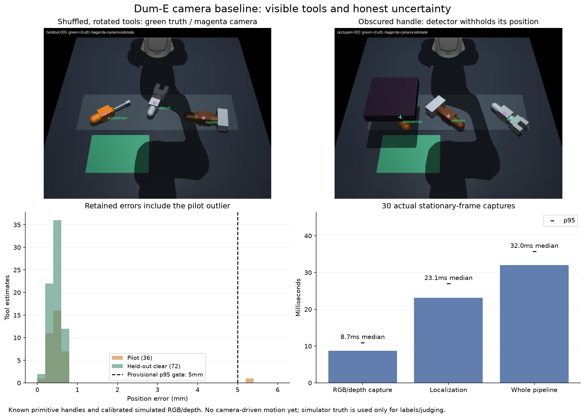

# Simulated camera perception baseline — October 11, 2026

The first camera-only localizer works on the current simplified tool models.
On 24 held-out clear layouts it finds all 72 tools with 0.48mm median / 0.67mm
p95 position error. It withholds all 12 deliberately obscured handles. Actual
RGB/depth capture plus localization takes 32ms median / 36ms p95 in a separate
stationary-scene probe. This is an offline observation milestone, not yet
camera-driven manipulation, arbitrary real-tool recognition or hardware readiness.
The full workbench goal remains active.

Perception estimates where things are from images. Planning will use those
estimates to choose movements. Keeping the two separate lets us measure mistakes
before letting a bad estimate guide a grasp.

## Camera placement and observation contract

Our initial overhead camera is mostly blocked by the arm. We retained that failure
and compared three actual rendered viewpoints. The front oblique view sees all
three handles: camera position (1.05, 0, 0.9)m, looking toward (0.46, 0, 0.03)m,
40-degree vertical field of view, 640x480 pixels and zero stereo offset. The
public assistant's existing camera, controller and voice workflow remain unchanged.
This experiment uses a separate physics world with initial scene layouts followed
by gravity/contacts; it never teleports a tool during a manipulation task.



`CameraCalibration` maps pixels and optical-axis depth into workbench coordinates.
`RGBDFrame` contains only color pixels, depth and calibration. `locate_tools` has
no simulator imports, labels, object IDs or nominal rack coordinates. Missing or
ambiguous estimates contain no position. The sensor/annotation adapter is separate;
privileged simulator poses and segmentation IDs are used only to make labels and
judge outputs. Source images and depth arrays are hashed, and labels are read only
after inference in the benchmark.

We retain the installed MuJoCo 3.15.0 classic renderer and locked dependencies.
Its depth output is metric axial distance, checked against a known rendered mat
plane to within 0.5mm. macOS reports an OpenGL clip-control precision warning;
we retain the warning and validate the measurement rather than assuming precision.
The camera axes and field-of-view convention follow the
[MuJoCo camera documentation](https://mujoco.readthedocs.io/en/stable/modeling.html#cameras).
The [renderer documentation](https://mujoco.readthedocs.io/en/stable/programming/rendering.html)
describes the classic and newer backends; migration is not required for this probe.

## Detector assumptions and frozen judge

The detector uses the existing handle colors, measured depth and the known
44x56mm flat top faces. It finds pixel islands, isolates the highest roughly
horizontal surface, fits its rectangle and estimates the handle center 22mm
below that surface. Neutral metal candidates are distinguished from the larger
hammer head by their size. Two equally plausible handles cause an ambiguous
result. No markers, pretrained vision model or new dependency were added.

This is a catalog-based geometric baseline. It assumes our primitive handles,
their material colors, a horizontal table, known camera calibration and a known
workbench volume. It does not recognize arbitrary screwdrivers or hammers in a
real room. `fit_score` measures geometric agreement and is not a probability.
Another similarly colored/shaped object can confuse it; the duplicate-handle
test proves abstention for that specific case, not general unknown-object safety.

The frozen fixture has 48 scenes: 12 pilot, 24 held-out clear, and 12 held-out
occlusion cases. Tool identities are shuffled among rack slots, x/y positions
vary, yaw spans the full circle, and lighting varies. The fixture was frozen
before tuning or benchmarking, SHA256:
`3c88327d24eefceaaec2769a80e4fc3860110c35e98c63c31c2bc2bfc02e46b4`.
No detector tuning followed the first pilot run. Provisional offline acceptance
was fixed at 95% clear coverage, p95 position error under 5mm, no confident
occluded target and no identity confusion. Existing physical success thresholds
and voice/Stop criteria were not changed.

| Judge | Observed result |
| --- | --- |
| Pilot visible tools | 36/36; median 0.49mm, p95 0.67mm |
| Pilot maximum error | 5.29mm, wrench in pilot-005; retained |
| Held-out clear tools | 72/72; median 0.48mm, p95 0.67mm, maximum 0.73mm |
| Obscured target handles | 12/12 withheld; zero confident target estimates |
| Identity confusion in fixture | Zero |
| Other tools in occlusion scenes | 23/24 observed; wrench in occlusion-002 withheld as ambiguous |

The pilot outlier has a lower geometric fit score (0.655), and the inferred
rectangle axes/extent are biased. That association is observed; the precise
cause is not proven. It needs conservative gating or better fitting before
general motion use. We do not hide it behind the passing p95 criterion.



Independent checks cover an additional rotated/permuted layout, actual metric
depth against a known plane, missing depth, an obscured handle, invalid calibration
and two identical visible wrench handles. The latter returns ambiguity with no
position. An analytic test initially used zero absolute tolerance at an expected
zero and failed on 2.22e-16m arithmetic roundoff. Its arithmetic-only tolerance
was corrected to 1e-12m; the actual 0.5mm plane check and fixed 5mm judge stay intact.

## Responsiveness and reproduction

Thirty sequential actual captures of one stationary scene give:

| Stage | Median / p95 |
| --- | ---: |
| RGB/depth capture | 8.7 / 10.9ms |
| Localization | 23.1 / 27.0ms |
| Whole capture-to-estimate pipeline | 32.0 / 35.7ms |

Scene preparation took 288ms; the first capture-to-estimate sample took 51.7ms.
These are local observations while the public assistant was idle, not a camera
hardware rate, active-motion latency, IPC timing or real-room guarantee. Dataset
image/depth disk IO and plot drawing are outside those pipeline measurements.
Fresh full regression suites pass: 147 lab / 128 fork tests, Ruff and formatting;
all 46 pinned upstream source hashes match. Engine-generated warning logs remain
local and ignored, while the warning and its measured accuracy check are documented.

From the lab or exported fork extension, use new output directories:

```sh
uv run --locked python scripts/generate_camera_dataset.py runs/camera-data-new
uv run --locked python scripts/benchmark_perception.py runs/camera-data-new runs/camera-pilot-new --split pilot
uv run --locked python scripts/benchmark_perception.py runs/camera-data-new runs/camera-heldout-new --split heldout
uv run --locked python scripts/benchmark_camera_pipeline.py runs/camera-timing-new
uv run --locked pytest -q tests/test_perception.py
```

`camera-perception-evidence.json` preserves fixture hashes, predictions, misses,
labels, actual errors, camera-view observations and timing samples. Raw synthetic
RGB/depth datasets remain ignored locally. Rebuild the figure with
`scripts/plot_camera_perception.py` in the lab's locked Matplotlib environment;
the fork's detector needs no plotting dependency. No webcam or microphone access,
paid service, hardware purchase or real actuator was used.

Next integrate fresh camera estimates into actual pickup planning and verify the
whole physical journey. Existing placement/carry/recovery code uses privileged
tool offsets and geometry, so simply substituting the initial pickup position
would not establish a camera-based controller. Separate planning observations,
robot proprioception and outcome judging; handle uncertainty and staleness without
a silent truth fallback. Keep independent Stop, measured placements and task
changes. Camera operation, recovery, useful learning, acoustic/noise testing,
hardware adaptation and the user live demonstration remain incomplete.
