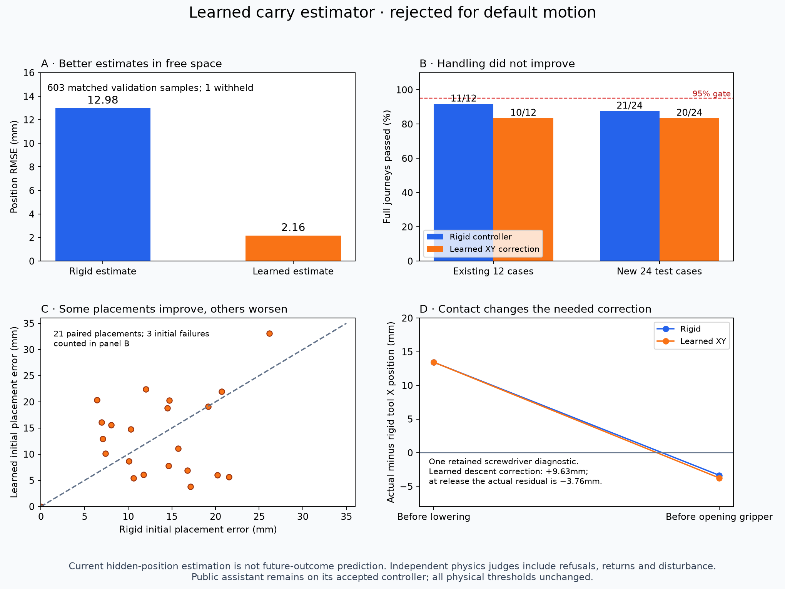

# Learned carry-position experiment — D2b

The small neural network estimates a carried tool's current position much more
accurately than a rigid-grasp assumption, but **does not improve handling**.
On 24 new physical test layouts, rigid control passes 21 complete journeys and
learned XY correction passes 20. Neither reaches the unchanged 95% gate. The
checkpoint is published as an experimental, rejected candidate; the working
voice assistant continues on its accepted controller. The full goal stays active.

The practical lesson: knowing where a tool is now is different from predicting
where it will end up after lowering and letting go. Table contact changes its
position within the fingers. Improving the first prediction does not establish
that the robot should use it as a final-placement correction.



## Model, data and information boundary

The actor receives RGB/metric axial depth, known calibration, camera-inferred
tool identity/direction and robot joint/TCP/gripper/clock telemetry. Added joint
velocities and actuator forces are **robot-side simulator proxies**. No true tool
positions, rotations, offsets or segmentation IDs enter inference or actuation.
The collector reads privileged labels only after forming actor features; the
separate physical verifier judges actual lift, placement, return and disturbance.
Tools remain free bodies with contact and gravity, without welds or teleportation.

Handle rectangles alone have a 180-degree direction ambiguity. A new catalog
cue uses measured distal metal pixels/depth to choose a direction when one side
has at least 20 cue pixels and over three times the other side. Otherwise the
direction stays unknown. Pilot direction coverage was 35/36, with maximum error
1.82 degrees against initial scene yaw. Independent rendered tests compare full
heading with actual body orientation. This is known-tool geometry, not general
recognition. D1 position regressions remain 72/72 clear tools, p95 0.257mm, and
all 12 hidden targets withheld. Timing from that concurrent regression is not a
clean pipeline speed comparison. A new serialized 30-capture run measures the
optical pipeline at 73.4ms median / 76.1ms p95, versus D2 59.7ms / 64.8ms. Scene
preparation is 293ms and first capture/estimate 97ms. These are separate stationary
runs, excluding motion/IPC/IO; the heading cue adds useful information and cost.

The first model used 39 features and 6,915 parameters. Its 12-episode validation
p95 error was 7.059mm, failing the fixed 5mm gate. The original training journeys
were correlated with tool identity. Before the second fit, we froze 72 additional
training-only episodes balancing tool and journey, and added robot telemetry.
The validation/test cases, thresholds and training hyperparameters stayed fixed.

Candidate 2 uses 54 features and two 64-unit ReLU layers, totaling 7,875
parameters. Features include tool one-hot identity, camera heading, initial
inferred offset, grasp/current robot pose, elapsed grasp time, finger gap, joint
velocities and actuator loads. Targets are actual-minus-rigid translation in the
hand frame. **Training samples cover free-space carrying above 80mm only**, not
table contact or release. Training normalization uses training episodes only.

The collector attempted 126 training and 12 validation trajectories. Eight
training trajectories produced no samples; their refusals/outcomes are retained.
The second fit used 6,096 rows from 118 training episodes and evaluated 604 rows
from 12 separate validation episodes. The 24 physical test layouts were excluded
from all collection/fitting and first opened after the policies were fixed.

Fixed fixture SHA256: `265ae7aedb6c05fc7fe99b96eafbdb4f32b38629a0d92b7b774531aed7887e86`.
Training-only extension: `00a916eec03b7f39d22c6d5e2b9a8daf6ee9196ed215621d91aacf81f81f4354`.
Dataset: `01ceff4b9b877eb35e27cd7b6368f65551f64a4ef4f754677c1331ae78c1d49d`.
Candidate 2 checkpoint: `e0c74098d267ae644a6f252027976a71d08d6ca1c0e31f01b610c54c3eaf91f9`.

## Accuracy, responsiveness and physical results

Candidate 2 withheld one validation input outside its experimental feature
range. Its 8-standard-deviation input bound and 40mm correction bound are
provisional rejection rules, **not calibrated uncertainty or safety guarantees**.
The withheld row's rigid residual was 63.70mm; it is counted, not discarded.
On the same 603 covered samples, rigid position RMSE is 12.976mm and learned
RMSE is 2.159mm. Learned p95 is 4.372mm and maximum is 7.309mm. The overall
offline gate still fails because coverage is incomplete.

Standalone NumPy inference measured 3.507ms median / 3.797ms p95 on this Mac
(first re-evaluation), and a final same-checkpoint run measured 3.526ms / 3.936ms,
under the frozen 5ms inference gate. This includes normalization and rejection
checks, not camera capture, planning or speech. Candidate 1's roughly 0.013ms
timing ran inside the PyTorch process with different numerical runtime conditions;
it is not an equivalent speed comparison. This estimator's few milliseconds are
small beside the optical pipeline and previously measured voice/LM delays.

| Frozen physical comparison | Rigid | Full XYZ correction | XY at descent |
|---|---:|---:|---:|
| Existing 12 full journeys | 11/12 | 10/12 | 10/12 |
| New 24 full journeys | 21/24 | Not tested | 20/24 |

Physical limits are unchanged: lift at least 80mm, placement below 35mm,
resting height below 40mm, speed below 30mm/s, unrelated-tool disturbance below
4mm; Stop holds 608ms with grip retained and joint drift below 0.03rad. The
complete-journey gate remains 95%. Refusals count as failures; a good initial
placement cannot hide a failed fresh-camera return.

The first policy applied XYZ correction during transport and descent. It fixes
the original hammer disturbance from 4.14mm to 1.51mm, but introduces two return
refusals. One screwdriver's new resting pose lacks a clear direction cue; one
wrench has a weak fit. Average initial-placement error on those 12 cases grows
from 12.83mm to 15.73mm. The second bounded policy keeps the original transport
path and applies only XY correction before lowering. It also passes only 10/12,
with the same return failures. We did not repeat hyperparameter/policy tuning.

On new layouts both controllers have two initial geometric refusals (test-001,
test-019) and one unreachable pose (test-007). Learned XY adds a return-direction
refusal (test-009). The average error among 21 paired initial placements is
13.27mm rigid / 13.04mm learned; this tiny placement difference does not improve
full-journey success. No tuning took place after opening these test cases.

An evaluator-only screwdriver diagnostic records actual-minus-rigid X residual
changing from +13.45mm before lowering to −3.36mm just before release. The learned
XY policy applies +9.63mm based on the airborne estimate; its actual residual at
release is −3.76mm and placement becomes worse (8.71mm to 18.60mm). This supports
the missing contact/release prediction hypothesis. It does not precisely separate
slip, servo behavior and contact forces. Post-release rigid estimates are invalid
because the tool has been intentionally detached; they are not model scores.

The original candidate-2 fit wrote its checkpoint but evaluation raised on the
one guarded input before metadata was saved. We retained the checkpoint and
re-evaluated it without retraining. Its fit duration is unknown. Torch 2.14.1 on
CPU, seed 721084, 300 epochs, Adam at 0.003 and batch size 256 are recorded.
Future fits persist metadata before evaluation and report refusals explicitly.
Neither a third fit nor a false duration was added to tidy the report.

## Reproduce and continue

Inference and physical comparison work in the existing locked fork extension;
choose new output folders rather than overwriting evidence:

```sh
uv run --locked python scripts/verify_camera_delivery.py runs/carry-rigid-new \
  --fixture fixtures/carry_model_cases.json --split test --return-after-delivery
uv run --locked python scripts/verify_camera_delivery.py runs/carry-learned-new \
  --fixture fixtures/carry_model_cases.json --split test --return-after-delivery \
  --carry-model src/physical_ai_lab/assistant/assets/learned/carry-position-v2-rejected.npz \
  --carry-policy xy_descent
```

Fit only in the lab's locked environment, which already includes PyTorch and
Matplotlib. The lightweight fork environment intentionally has no Torch:

```sh
uv run --locked python scripts/collect_carry_data.py runs/carry-data-new \
  --additional-training-fixture fixtures/carry_training_extension.json
uv run --locked python scripts/train_carry_model.py runs/carry-data-new runs/carry-fit-new
uv run --locked python scripts/evaluate_carry_model.py runs/carry-data-new \
  runs/carry-fit-new/model.npz runs/carry-eval-new
uv run --locked python scripts/plot_carry_learning.py
```

These are reproduction commands for this closed experiment, not permission to
tune on its opened tests. Existing cases now become regressions. Next freeze new
training/validation/test layouts and learn **future contact/release outcomes from
observations plus proposed actions**, comparing actual physical improvement.
Resolve viewpoint/fit and reachability failures, direction coverage and all-phase
recovery before integrating camera control into the public assistant. Camera
integration, useful learned-model gains, noise/live audible latency, hardware
adaptation and the required human demonstration remain unfinished.

Validation: 20 focused estimator/camera tests, the full 161-test lab suite and
independent 142-test exported fork suite pass. Ruff/format pass for 80 lab and
56 fork Python files. All 46 pinned original upstream hashes match. No physical
acceptance failure is turned into a unit-test pass.

Detailed retained outcomes and metadata: [carry-learning-evidence.json](carry-learning-evidence.json).
