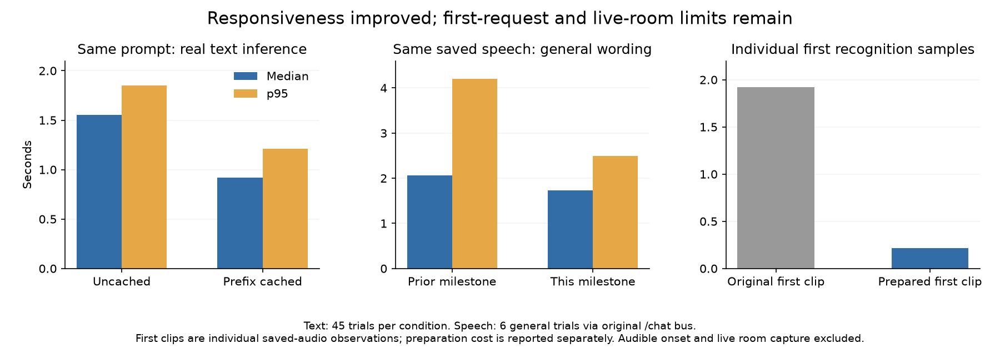
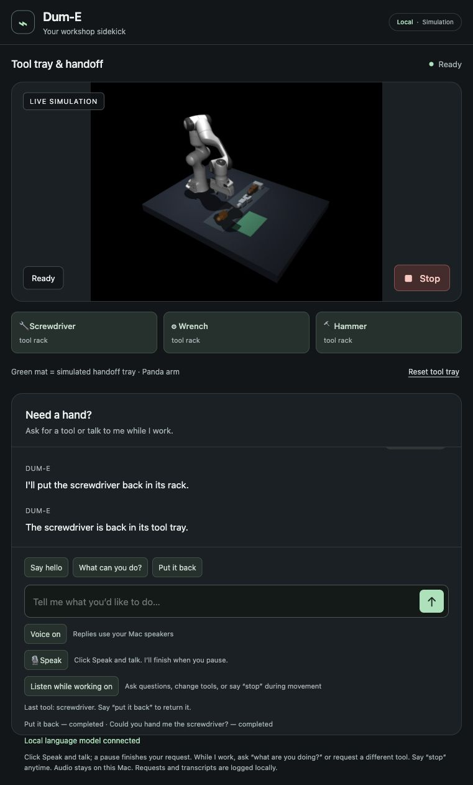

# Faster dialogue and interruption during thinking — October 11, 2026

This is another verified milestone toward the adopted workbench goal. Camera
perception, learned skill improvements, hardware adaptation and a convincing live
room demonstration remain required. Measurements below use synthetic speech/text
and real local inference/physics, not the user's voice or room microphone.

## What changed

The local model reread fixed instructions on every request. We now prepare a
token-exact prefix once, then clone its complete cache for each request. Current
scene observations and conversation are always processed afresh. This matters
for this hybrid model: its recurrent state cannot safely be trimmed like an
ordinary attention-only cache. A prefix mismatch falls back to full processing.
Physical decisions still require complete, parsed JSON; streaming fragments do
not operate the arm. The same model and locked dependencies remain in use.

The model also confused “Which tool is useful for tightening nuts?” with a request
to fetch a wrench. The prompt now distinguishes information from a physical
request. The controller supplies physical acknowledgments/results, so the model
does not generate redundant messages for fetch/return/resume/Stop. Idle questions
and clarification now use the same read-only interpretation as conversation
during work, without acquiring a physical job. Familiar physical commands retain
their direct route. Model-selected physical intents are reused, not regenerated.

The largest interaction defect was different: after recognizing a question, the
capture controller awaited the entire answer before listening again. It now
rearms during movement as soon as recognition dispatches the question. Spoken
Stop remains available while inference is pending. The server snapshots each
request's cancellation epoch at arrival, so Stop invalidates both active and
queued dialogue. A late answer cannot initiate movement or rearm listening.
The previous published capture controller fails the new pending-reply judge
with mode `transcribing` instead of `recording`; its earlier probes still pass.
That synthetic callback comparison isolates the defect without using a microphone.

Startup now exercises actual decoding before reporting ready. Speech preparation
follows the language model's large allocation/prefill, using a bundled synthetic
phrase through the ordinary recognizer. No microphone, speaker or robot is used
by either startup preparation. The UI waits for speech and language availability
before enabling idle Speak, and shows Thinking for pending idle interpretation.

## Measured results

The 15 dialogue cases and expected decisions were fixed before baseline collection,
then repeated three times. Their SHA256 is
`2f4dd3530e5cc35a59e6716e0dfd96c16d773b989d956d01d87438086875695d`.
They include functional tool descriptions, information, hypothetical/negated
requests, unsupported assembly, ambiguity, chat and contextual tool choices.
The `/understand` judge never actuates; its native job stays unchanged.

| Real read-only text inference, 45 trials | Median | p95 | Intent/schema mismatches |
| --- | ---: | ---: | ---: |
| Original prompt | 1.500 s | 1.827 s | 6 |
| Corrected prompt, cache off | 1.555 s | 1.852 s | 0 |
| Same corrected prompt, prefix cache on | 0.917 s | 1.213 s | 0 |
| Ordered-preparation run, before final contextual wording | 0.914 s | 1.224 s | 0 |
| Final contextual prompt | 0.896 s | 1.190 s | 0 |

The matched prompt comparison isolates about a 41% median reduction from caching.
The original errors comprise three tool questions wrongly requesting a fetch and
three unsupported answers retaining an object despite the expected nonphysical
schema. The unsupported results were nonacting; the informational fetch errors
were materially different. No fixture or parser expectation was relaxed.

The matched cache probe retains 771 fixed tokens; final contextual wording retains
845. Both observed caches occupy about 85.4 MB. Warm prefill drops from
roughly 0.85–1.0 seconds to about 0.40 seconds for the short text cases. Remaining
prefill grows with actual conversation and scene context. These text timings
exclude recording, pause detection, recognition, audible speech and movement.

The original 30 saved-speech bus replay retains identical waveforms, decisions
and end-of-speech boundaries. All 30 pass:

| Last voiced sample → native decision | Before median / p95 | After median / p95 |
| --- | ---: | ---: |
| Familiar commands, 18 trials | 1.190 / 1.215 s | 1.170 / 1.217 s |
| All 30 trials | 1.204 / 2.907 s | 1.174 / 2.429 s |
| General wording, 6 trials | 2.066 / 4.198 s | 1.735 / 2.498 s |

This is the original `/chat` task-bus interface. The current UI uses `/interact`;
its separate replay observes native decisions for physical jobs and read-only
API replies for conversation. These two observation endpoints are identified in
each row and must not be silently treated as identical. Both replays use the
shipped pause controller, real-time saved audio, local ASR and real task interfaces.
They exclude audible response onset, successful placement and live room behavior.
Semantic wording in the bus replay still exceeds the provisional two-second
decision objective; common commands meet it. No target was lowered.

The final current-UI replay passes all 30 cases: common median/p95 1.167/1.287
seconds, overall 1.167/2.614 seconds, general 1.691/3.111 seconds and guards
1.718/2.614 seconds. Its semantic tool request is now correctly fetched after
prior chat, but the first such trial took 3.111 seconds and later ones 2.326/2.284
seconds. The broader delay remains. An information reply uses the read-only API
endpoint and acquires no physical job; a physical request uses native intent
observation. These mixed endpoints are identified, not conflated with the original
bus replay above.



In a separate pending-answer journey, two consecutive saved recordings went
through the shipped controller while the arm held a screwdriver. Spoken Stop
was posted **530 ms after the last voiced sample**. The model was still answering:
its superseded reply resolved 2.73 seconds after Stop. The original task remained
cancelled, the gripper command stayed closed, and settled drift was
`2.95e-8 rad` over the subsequent 600 ms. This is one end-to-end observation, not
a p95 estimate or an acoustic microphone test.
The final-source repetition also passes: 539 ms end-of-Stop to POST, reply
superseded 2.05 seconds after Stop, drift `2.43e-8 rad` and retained closed grip.

## Startup work is measured, not hidden

The first original text request took 6.174 seconds. The corrected-prompt control
took 5.364 seconds, prefix-only caching 3.055 seconds. Read-only startup decoding
produced one 0.769-second first text request, but a later first request after
speech preparation still took 2.528 seconds. Do not claim every first response
is fast, or infer performance after a long idle period from warmed trials.

Prefix preparation took 2.264–9.424 seconds across the successful startup probes.
One read-only decode added 1.430–4.453 seconds; total language preparation was 10.641–18.797
seconds. Ordered speech preparation then took 3.593 seconds in the observed run.
These costs occur before ready, not inside a silently excluded user request.
Client readiness-wait measurements start when that client is launched and are
not total application startup measurements. OS/file caches were not purged.

The same 3.0945-second speech fixture originally needed 1.924 seconds of
recognition: audio decoding 0.053 seconds, model recognition 1.870 seconds.
Later identical clips took 0.166/0.150 seconds. Synthetic warmup before language
startup was insufficient: an isolated first clip still took 1.135 seconds.
After ordering speech preparation last, the first clip took 0.214 seconds
(model 0.183), then 0.148/0.149 seconds. That supports the startup-order change;
allocation/paging is a hypothesis, not a measured explanation. Concurrent
recognition during another benchmark was retained separately and excluded from
the isolated comparison. Speech thresholds and decoder-only short-clip padding
remain unchanged. A second startup's first user-path recognition used a different
phrase, “Could you hand me the wrench?”, after the native dialogue benchmark. It
took 0.163 seconds (model 0.127), supporting more than exact-fixture reuse.

## Validation, failures and reproduction

141 lab tests and 122 exported fork tests pass, including cache/context isolation,
startup ordering, original shared-memory cancellation, all ordered tool changes,
late hammer returns and deliberately failed grasps. Upstream hashes, Ruff and
the shipped JavaScript capture probes pass. The strengthened real interaction
journey proves an idle tool question creates no job, then exercises spoken question,
tool change, Stop/resume, contextual return, actual model conversation, withdrawal
and clarification across completion. Its stopped/resumed change places the
screwdriver at 6.21 mm and wrench at 7.16 mm error; hammer withdrawal returns at
16.36 mm. An earlier probe's general joke took 1.93 seconds; final verification
took 3.29 seconds after more conversation, versus the previous milestone's
6.01-second first joke. Startup state/context differ: this is not a paired speedup
and does not establish consistently fast conversation.

The final clean browser session independently asks “What are you doing?” during
visible Working. Its reply uses the observed state; the same single physical job
continues to verified delivery (9.67 mm), then a browser return places it back
at 11.40 mm. An earlier visible tool question changes neither job/task records
nor tool locations, and a natural-purpose request delivers a screwdriver. Thinking
is visibly shown during that idle interpretation. Voice and active-work listening
are restored; the app is left Ready with all tools in their racks. Return phases
now name the actual rack rather than the handoff tray. The screenshots are real
browser captures, not mockups. This is typed browser evidence, not live voice proof.



The first current-UI replay then exposed three present tool needs being answered
informationally after capabilities chat. That failure was retained, and the prompt
now explicitly distinguishes a current tool need from a tool question, hypothetical
or negation despite earlier conversation. All 45 original cases still pass; 18
additional mixed-history cases also pass (median/p95 0.867/1.228 seconds). Their
separate fixture hash is
`b0d7118ce4c9711126a555287ffa2b4c775bac619f1acf82b885095ac41951d8`.

Failures remain visible: cache preparation initially violated this tokenizer's
requirement for a user query; we corrected the template-only boundary probe.
The first strengthened idle-question check caught routing through the task queue.
Two pending-Stop verifier runs used the wrong joint-field name and have no final
pass. After inspecting `robot_joints`, the verifier validates its seven-element
array before movement and passes the full settling judge. No physical success
threshold was changed. Raw runs/audio remain local; `dialogue-evidence.json`
contains only synthetic evidence and measured outcomes.

A final concurrent test/export run failed once while MuJoCo read `link3_1.obj`
(insufficient vertices). Every pinned asset hash subsequently matched, including
that mesh's 777 vertices; a serial fork run passed all 122 tests. Export previously
used `copy2` directly over existing assets, which can expose a truncated file to
a running reader. Concurrent export is the leading explanation, not a captured
trace proving the exact read timing. Export now skips identical files and copies
changed files to a temporary sibling before atomic replacement. Two lab tests
verify that readers retain the complete old file during copying and on failure.
Do not export during verification: replacement of separate files is not a whole
project transaction. A sandboxed rerun also failed its 18 IPC fixtures because
Unix socket binding was denied; the IPC-enabled serial run passed unchanged.

From the lab:

```sh
uv run --locked --extra assistant --extra dume dume-sim
uv run --locked python scripts/benchmark_dialogue.py runs/new-dialogue-run
uv run --locked python scripts/benchmark_dialogue.py runs/new-context-run --fixture fixtures/dialogue_context_cases.json
node scripts/benchmark_responsiveness.mjs runs/new-bus-run runs/responsiveness-fixtures-001
node scripts/benchmark_responsiveness.mjs runs/new-ui-run runs/responsiveness-fixtures-001 --frontend
node scripts/verify_pending_voice_stop.mjs runs/new-pending-stop-run
uv run --locked python scripts/verify_interaction.py runs/new-interaction-run
```

The exported fork uses `uv run --locked dume-sim` inside `extensions/workbench`.
Output directories must be new. For the matched uncached control, restart with
`WORKBENCH_PROMPT_CACHE=0`; this also disables prefix/decode preparation. Never
run competing manipulation verifiers together. Record startup separately, retain
failed runs, and compare identical fixtures/observation endpoints.

Still open: live voice/noise/overlap and internal pauses, actual audible onset,
larger dialogue distribution, first/long-idle model latency, perception, varied
layouts, measured learning gains and a hardware adapter/plan. The text echo
heuristic remains a heuristic; listening remains visible and active-work-only.
