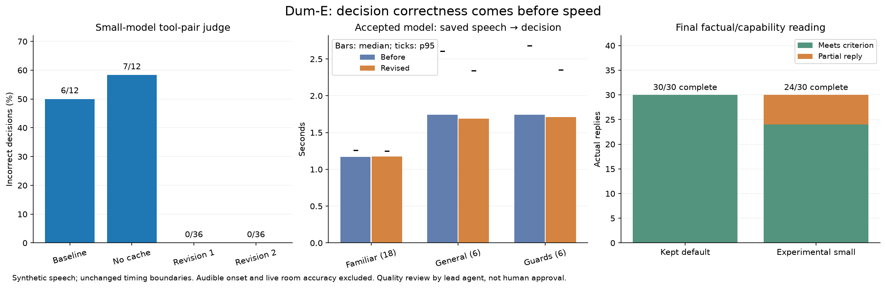
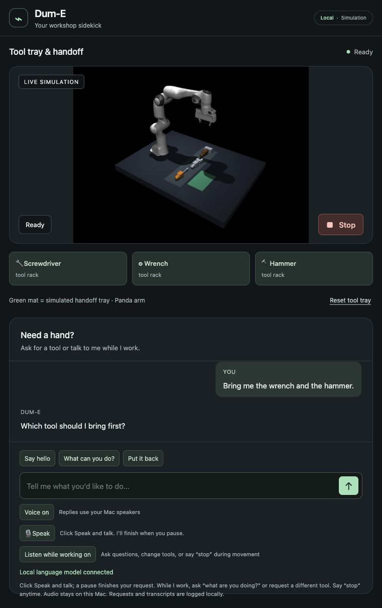

# Bounded dialogue revision — October 11, 2026

Keep the existing large local model. The revised instructions shorten replies,
explain simulator-only perception consistently, and clarify multi-tool requests.
The small candidate now selects the correct intent in the fixed speech workflow,
but still gives incomplete capability and verification explanations. It remains
experimental. No new model download, dependency or microphone scope was added.
The broad goal remains active, including camera perception, measured learning,
hardware adaptation and a convincing human live demonstration.

## Grounding and bounded changes

The preceding study found an actual spoken wrench-and-hammer request incorrectly
selected a wrench. Its native case used a different tool pair and history. We froze
12 additional cases before changing the prompt: all three supported tool pairs
under fresh, capabilities, and fetch/decline history; plus preference, information,
and negative controls. SHA256:
`8b97a4bd1278576e281170ce82ab1dfa8cd3857807c969c2e3e0a1977a40541d`.
Original 45, contextual 18, quality 30 and saved-speech 30 judges are unchanged.

Unchanged large-model decisions pass 12/12. The unchanged small model fails 6/12;
with prefix caching disabled it fails 7/12. Both tool pair and prior chat matter,
and cache reuse alone does not explain the problem. Native understanding is
read-only and did not submit physical jobs during any of these probes.

Attempt 1 explicitly selects requested tools from the current utterance, supplies
complete clarification JSON, distinguishes preference/negation from requesting
both tools, replaces contradictory "sensor data" with simulator positions, and
aims for one spoken sentence of at most 25 words without truncating important facts.
The familiar capabilities response also names conversation and simulation. Pair
36/36, context 18/18 and quality-schema 30/30 pass, but original 3/45 fail: ordinary
chat selects a wave. The failures remain in the evidence.

Attempt 2 limits gestures to explicit greetings, thanks or requested expression;
gives a complete short abilities example; and states that only verified controller
results establish success. No third prompt revision was made. JSON is still parsed
completely before execution. Parser, sampler, token limit, fixed fixtures, Stop
priority, controller paths, physical success thresholds and upstream assets remain
unchanged. Prefix caching includes the new instruction tokens.

## Results and decision

| Final read-only text, median / p95 seconds | Kept large model | Experimental small model | Incorrect decisions |
| --- | ---: | ---: | ---: |
| Tool pairs, 36 | 0.918 / 1.189 | 0.903 / 1.091 | 0 / 0 |
| Original, 45 | 0.942 / 1.189 | 0.969 / 1.184 | 0 / 0 |
| Mixed history, 18 | 0.965 / 1.197 | 0.815 / 1.097 | 0 / 0 |
| Reply quality schema, 30 | 1.026 / 1.273 | 1.081 / 1.297 | 0 / 0 |

Reading all actual quality messages gives 30 complete replies for the large model
and 24 complete / 6 partial for the small model. Three small abilities replies
omit simulation. Three denials wrongly describe a request OR movement as sufficient
for delivery; they do decline the requested false success and never actually assert
a fabricated delivery. The adopted goal requires verified execution, so the flawed
explanation is a factual partial. This is lead-agent review, not human approval.
Every actual reply and criterion is retained rather than equating valid JSON with
good conversation. The large model's matched prior review had 27 complete replies,
with abilities omitting conversation.

The large model's reply length falls from a median 17 words (maximum 37) to
12 (maximum 18) on the matched quality set. The small model falls from 23/34 to
13/20. These are observations on this fixture, not a guarantee for arbitrary text.

| Current UI saved speech, median / p95 seconds | Large before | Large revised | Small revised |
| --- | ---: | ---: | ---: |
| Familiar commands, 18 | 1.172 / 1.257 | 1.174 / 1.247 | 1.170 / 1.206 |
| General wording, 6 | 1.743 / 2.609 | 1.688 / 2.341 | 1.562 / 2.057 |
| Guards, 6 | 1.740 / 2.683 | 1.711 / 2.350 | 1.571 / 2.063 |
| All 30 | 1.172 / 2.655 | 1.174 / 2.341 | 1.170 / 2.061 |

All final speech decisions pass. The small model's earlier three incorrect pair
decisions are corrected, but its factual partials still prevent a default switch.
Familiar-command latency is essentially unchanged; general/guard tails improve
modestly on the kept model. Only six trials support each tail estimate. Models run
sequentially, without concurrent GPU studies; order is not randomized. "Before"
is the retained preceding matched study, not a new randomized control.

Timing is the same last voiced 40ms sample → decision observation: real-time saved
audio, shipped pause controller, actual local ASR and current `/interact` route.
Conversation ends at its API reply; physical intent uses 40ms native polling.
Audible onset, completed placement, live room accuracy and overlapping speech are
excluded. The speech judge resets physics between cases while retaining dialogue
history. Live listening and speakers were off during automated motion.



## Startup, interruption, physics and remaining scope

The original loaded large-model app produced a 17.263-second first response after
an idle interval, despite model-ready status; subsequent responses took
0.761–1.303 seconds. This is not a fresh-start measurement. Paging or kernel
residency remains an unproven explanation. Final fresh runtime model preparation
was 20.451 seconds large / 4.071 seconds small, including prefix preparation
11.604 / 0.846 seconds and read-only startup decoding 2.346 / 1.006 seconds.
These are individual samples with uncontrolled OS caches, not cold-start
distributions. The kept model still carries its larger memory requirement; we
have not solved long-idle latency or adopted the candidate's memory savings.

Independent saved-speech Stop during a real pending model reply passes: 593ms
from the final voiced sample to Stop POST, late reply superseded, task cancelled,
grip retained, and maximum joint drift 3.56e-7 radians over the settling check.
The original pending-reply criterion was exercised without an artificial delay.

The full saved-speech/physics journey passes: screwdriver return 6.20mm, wrench
handoff 7.16mm, wrench return 4.60mm and withdrawn hammer return 16.30mm. A later
clarification survives completion and returns/retrieves both tools correctly.
The moving general joke still takes 3.186 seconds (first token 2.593 seconds),
so context/idle latency remains a bottleneck despite shorter generated text.
All original placement, grip, cancellation and unrelated-tool checks are retained.
Fresh full suites pass: 141 lab / 122 fork tests, plus Ruff and format checks.
Every pinned original Dum-E source hash matches. No candidate physical-recovery
pass is claimed: its quality gate failed. The final app is restored with the kept
model, tool tray Ready, voice and active-work listening available.

A clean real browser exchange answers a capabilities question and clarifies the
wrench-and-hammer request. No native job or physical task is created; maximum
tool drift is 6.72e-9m. Reset clears the pending clarification. The controls are
restored with voice and active-work listening on, without idle recording.



Reproduce native checks with `scripts/benchmark_dialogue.py` and each fixed
`fixtures/dialogue*_cases.json`; speech with `scripts/benchmark_responsiveness.mjs`
and `--frontend`; Stop with `scripts/verify_pending_voice_stop.mjs`; full physics
with `scripts/verify_interaction.py`. Use new output directories. Candidate
reproduction remains documented in model-comparison-audit.md; no new weights are
required. Plot source reads only the saved public evidence and uses the lab's
existing Matplotlib dependency, optional for the fork:

```sh
MPLCONFIGDIR=.cache/matplotlib XDG_CACHE_HOME=.cache uv run --locked python scripts/plot_dialogue_revision.py
```

Rollback is the accepted A2 prompt/model (fork 76da19f still has that runtime).
After this bounded language study, advance camera-derived workbench observations
with simulator truth used only as the judge. Varied-layout handling, observed
failure recovery, useful learned models, acoustic/noise evaluation, hardware
adapter/plan and the user live demo remain required. No hardware or camera access
was enabled by this study.
