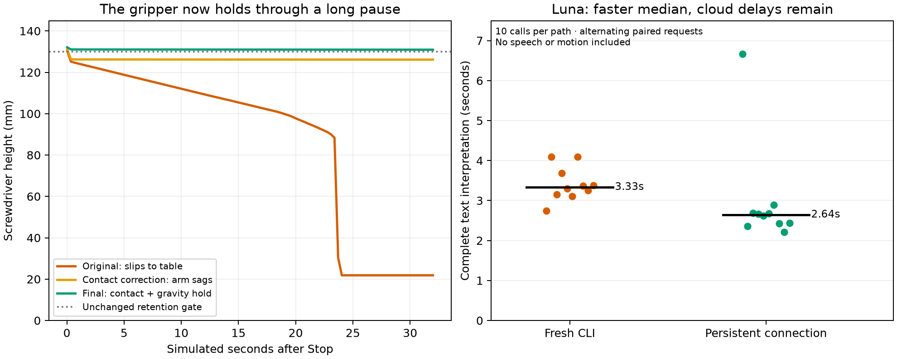
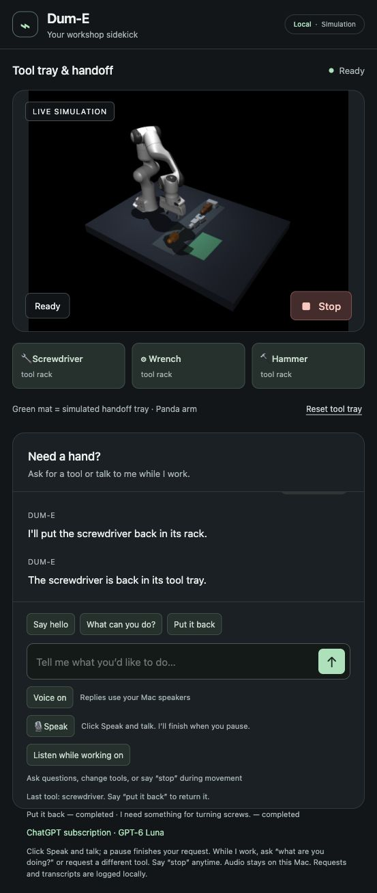

# Paused tool retention and Luna responsiveness — October 12, 2026

The simulated arm now retains tools through a long Stop and can continue to a
verified delivery or return. Luna's median complete text response is faster with
a persistent subscription connection. Cloud tail latency remains variable.



## What changed

The original Stop held each arm servo at its measured joint angle. A position
servo needs an error to produce torque, so the arm sagged under gravity. MuJoCo's
soft friction constraints also allowed slow contact creep: all nine original
tool/seed combinations eventually dropped their tools during a 32-second hold.

The final correction applies three NoSlip contact iterations and gravity
feedforward to the arm's paused servo targets. Gravity is calculated in separate
scratch simulation data; only the seven arm targets change. The real object
poses, velocities, gripper command, force caps and placement checks remain intact.
Tools are free bodies and fall when the fingers open. No object weld was added.

This is a simulation contact-model change, not learned grasping or proof of a
real gripper's capabilities. MuJoCo documents soft-constraint slip and its NoSlip
postprocessing, including extra computation, possible complex-contact instability
and ill-defined inverse dynamics. Our gravity calculation does not use inverse
dynamics. Future inverse-dynamics studies must account for this option, and
historical learned-model results collected with the old contacts are not silently
requalified. [MuJoCo modeling documentation](https://mujoco.readthedocs.io/en/stable/modeling.html).

The Luna backend now keeps the official signed-in `codex app-server --stdio`
process alive. Every utterance still starts a fresh ephemeral thread with only
the supplied recent dialogue and simulator observations. This avoids hidden
history while removing repeated process initialization. Unused skill/tool
metadata is trimmed with process-scoped configuration; the user's configuration
is not edited. Stop interrupts the active model turn and invalidates its response.

Authentication remains ChatGPT subscription sign-in, model `gpt-6-luna`, low
reasoning effort. API keys, model fallback, tools and agent capabilities are
disabled for this interpreter. Complete schema-valid output is required before
an action is selected. The timeout remains 30 seconds, with no automatic retry.
The microphone and local speech pipeline have not changed.

The app-server lacks `--ignore-user-config`, so configured MCP servers are
disabled explicitly, alongside shell, apps, plugins, hooks and other unused
features. Unsupported server names fail initialization instead of leaving tools
enabled. Server-initiated tool requests are rejected. Authentication and protocol
tests also verify rejection of API-key accounts, unchanged host configuration,
and cleanup of the persistent process. Stopping our actual idle launcher closed
its native simulator and Luna child; a process check found no abandoned child.
[Official app-server protocol](https://learn.chatgpt.com/docs/app-server),
[configuration reference](https://learn.chatgpt.com/docs/config-file/config-reference).

## Recorded checks

The reproducible hold comparison uses screwdriver, wrench and hammer, seeds
42/51/52, the same early-lift trigger, 1,000 ticks (32 simulated seconds), and the
unchanged gates: tool height above 130 mm, joint drift below 0.02 radians, grip
command retained. Changing contact settings also changes the preceding pickup;
these are matched task/seed rollouts, not identical frozen initial object states.

| Hold | Passes | Result |
|---|---:|---|
| Original contacts and arm hold | 0/9 | All tools drop to the table |
| Contact correction alone | 3/9 | Tools retained, but arm sag fails the height gate in six cases |
| Contact correction + gravity hold | 9/9 | Maximum joint drift 0.00960 rad; maximum final height loss 0.439 mm |

Nine regressions additionally open the fingers after the long hold and observe a
real drop. Six verify successful resume/return after 32 seconds. Existing varied
pause phases, disabled-gripper failures, camera/recovery, delivery and world-model
tests also pass. Full suites: 224 lab / 205 fork tests, followed by two additional
authentication/protocol cases in each checkout (nine focused transport/API tests
pass in each). All 46 protected upstream source hashes match.

The real main app, original Dum-E task bus and native physics also passed three
32-second wall-clock holds. Original cancelled task records stay cancelled;
continuations have new task records and pass the existing physical checks:

| Tool | Minimum held height | Continuation placement error | Subsequent rack error |
|---|---:|---:|---:|
| Screwdriver | 193.6 mm | Resume to handoff: 8.01 mm | 11.62 mm |
| Wrench | 136.5 mm | Return from hold: 6.09 mm | — |
| Hammer | 131.6 mm | Resume to handoff: 8.57 mm | 13.91 mm |

During the screwdriver lift, a real pending Luna question was superseded by Stop:
the interaction returned `superseded`, with no new task, within the next recorded
70.7 ms observation. A subsequent model question returned correctly and left
the grip unchanged. Stop POST replies took 2.5–4.1 ms; observing `Stopped` and no
busy task took 61.0–70.7 ms. These are typed HTTP endpoints and poll-bounded
observations, not spoken Stop timing or a measurement of zero mechanical velocity.
The original raw key `stop_settled_ms` is retained but explicitly interpreted this
way; the reusable script now calls it `stop_observed_ms`.

Luna passes all 43 frozen action/object cases once each. Lead review of the ten
factual replies passes their existing content criteria. No motion occurred in
those read-only qualification runs. This is not live-human voice validation.

| Alternating paired text test | Original fresh CLI | Persistent connection |
|---|---:|---:|
| Complete calls, five cases repeated twice | 10 | 10 |
| Incorrect intents | 0 | 0 |
| Median | 3.332 s | 2.642 s |
| Sample p95 (maximum with this small sample) | 4.089 s | 6.664 s |
| Median input tokens | 7,329 | 5,780 |
| Measured startup including read-only warmup | 3.389 s | 2.750 s |

The median improves 20.7%; input overhead drops 21.1%. One retained slow cloud
response makes the new sample's p95 worse. This small comparison supports the
median improvement, not a reliable tail-latency claim or an API-price estimate.
The separate 43-case sample has median 2.703 s, p95 5.163 s, maximum 6.981 s.
Both tests measure complete text interpretation, excluding capture, ASR, audible
onset and motion. Stop and familiar tool commands still have independent local
routes. No stronger latency conclusion is justified by these samples.

After restarting the final exported app, an actual browser request, “I need
something for turning screws,” went through Luna's session transport and delivered
the screwdriver with 9.49 mm placement error. The browser's “Put it back” button
returned it with 11.68 mm error. The assistant is Ready with all tools on the
rack, Voice and motion-time listening restored ON, and the microphone idle.



## Reproduce

From the lab root, with the existing environment and signed-in Codex:

```sh
WORKBENCH_LANGUAGE_BACKEND=codex uv run --locked --extra assistant --extra dume dume-sim
```

From `Dum-E/extensions/workbench`, omit the extras. The browser remains
`http://127.0.0.1:8766/`; the final main native simulator is on port 8765. Before
automated motion checks, turn Voice and Listen while working off in the tab.
Restore them after the tools are back on the rack. Do not run simultaneous model
inference when comparing latency.

```sh
python scripts/benchmark_luna_transport.py runs/new-luna-pair
python scripts/benchmark_stop_hold.py runs/new-stop-hold
python scripts/verify_hold_luna.py runs/new-live-hold
python scripts/plot_hold_luna.py
```

Use the project's Python environment; these scripts do not install dependencies.
The legacy Codex transport is available explicitly through
`WORKBENCH_CODEX_TRANSPORT=exec` for comparison/rollback. It does not provide the
new active cloud-turn interruption. The default Codex transport is `session`.

[Evidence and synthetic replies](hold-luna-evidence.json). Raw per-tick traces and
earlier failed experiments remain local in `runs/stop-hold-*`,
`runs/luna-session-*`, `runs/luna-transport-paired-001`, and
`runs/hold-luna-live-001`. Shipped runtime logs are under the fork extension's
`runs/hold-luna-main-001` and final `runs/hold-luna-main-002`.

The full workbench goal remains incomplete. The arm controller is still scripted;
Luna supplies conversation/intent, not a pretrained robot policy. Live microphone
and room-noise qualification, camera-informed default operation, actual OpenPi
execution on a supported workstation and eventual hardware adaptation remain
separate work. No hardware purchase or microphone scope expansion occurred.
