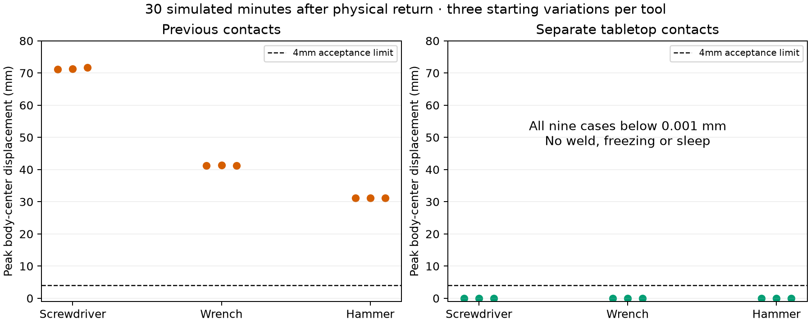
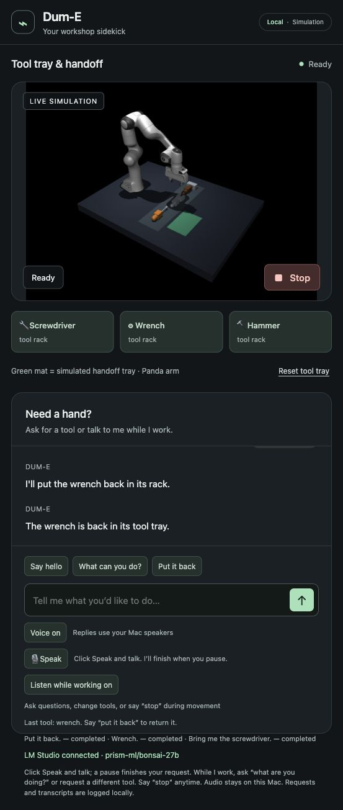

# Tool placement stability — October 12, 2026

The fixed tool/table contact model passes all nine frozen physical journeys:
pickup, 32-second paused hold, resume, handoff, return, 30 simulated minutes idle and
re-pickup. The previous contacts fail the same 4 mm idle limit in all nine cases,
with 31.12–71.68 mm body-center drift. The candidate's largest measured displacement
is 5.56e-7 mm across all three bodies; report this as **below 0.001 mm** in this
deterministic simulator test, rather than a claim of real-world precision.

## Cause and bounded change

The earlier three-iteration NoSlip treatment fixes gripper creep but exposes
slow movement on the flat tabletop. Both tools and table inherit six-dimensional
contacts: sliding plus torsional and rolling resistance. Explicit tool/table
pairs now use three dimensions (normal plus sliding), while gripper/tool pairs
retain six. This is a fixed modeling choice at initialization, not a contact
switch when a task ends. Actual contact records confirm identical sliding
friction, solref and solimp; masses, shapes, actuator force limits and the original
finger-coupling constraint also match. Opening the fingers still drops the tool.
[MuJoCo contact dimensions and explicit pairs](https://mujoco.readthedocs.io/en/stable/XMLreference.html#contact-pair).

The evidence supports the diagnosis that the previous NoSlip/contact combination
causes tabletop creep in this scene. It is not a general conclusion about all
six-dimensional contacts. MuJoCo documents possible NoSlip instability in complex
contact systems and limitations for inverse dynamics.
[MuJoCo slip guidance](https://mujoco.readthedocs.io/en/stable/modeling.html#preventing-slip).

No new motion algorithm, geometry, force-cap change, object weld, pose/velocity freeze,
engine sleep or model-specific behavior is introduced. The previous controller
and all retained physical gates remain in place. Bonsai remains the conversation
backend; this fix does not change language response timing.

## Evidence and rejected alternatives

`fixtures/idle_placement_cases.json` was frozen before the comparison. It covers
three tools × seeds 42/51/52. Each trajectory physically carries and returns the
tool before idle; it is picked up again afterward. Peak displacement is sampled
every 32 ms. The offline runner advances exactly 16 physical substeps per sample,
with no renderer or wall-clock pacing. A separate 1,000-frame comparison found
bitwise-identical integration state versus 16 individual `mj_step` calls; it found
no timing benefit, so the production stepping loop was not optimized this way.
The 1800-second duration refers to **simulation time**, not a 30-wall-minute test
of the browser or voice pipeline.

The candidate meets the unchanged 130 mm hold-height, 0.02 rad joint-drift, 80 mm lift,
35 mm placement-error, 40 mm resting-height, 30 mm/s resting-speed and 4 mm unrelated-tool
movement gates. All 27 delivery/return/re-pickup placements are 6.98–14.46 mm from
their target. Independent numeric review reconstructs these checks rather than
accepting the runner's boolean verdict. Separate tests inspect live contact
dimensions, matched physical parameters, actual release and re-pickup.

The failure history is retained:

- Identical post-return branches show 72.272 mm drift with the old settings and
  the same drift with tighter NoSlip early-termination tolerance. Removing
  NoSlip gives 0.094 mm drift. Separate NoSlip-free elliptic held-tool probes fail
  the retained height gate at both tested impedance ratios (10 and 100).
- Elliptic cones with NoSlip stabilize the matched idle branch, but a complete
  early-lift regression fails seed 51/hammer at 129.943 mm against the 130 mm gate.
  The global elliptic change was rejected. No gate was relaxed.
- The first matched-state diagnostic captured cached pre-integration positions
  and stopped before running idle branches. It was corrected by synchronizing
  forward kinematics before recording its reference.
- The first complete comparison computed results but failed JSON serialization
  on a NumPy boolean. No result from it is accepted. Explicit scalar conversion
  and a real short serialization pilot fixed the recorder; each completed stage
  now checkpoints atomically. The complete unchanged comparison was rerun.

Raw diagnostics are under ignored `runs/`; the public
[evidence bundle](idle-contact-evidence.json) contains synthetic measurements,
protocol hash, contact records and failures. Historical learned camera/carry/
release models were qualified against earlier physics and need requalification
before promotion under these contacts. No reserved camera test was opened here.

## Application state and remaining work

The launcher rejects old or unknown tool-contact profiles instead of silently
reusing a native simulator without the fix. `table_contact_dim=None` remains an
explicit offline research option for reproducing the old contacts. It is not the
public default. Research friction-cone choices are fixed before execution.

The full lab suite passes 238 tests and the exported fork passes 219. A restart
exposed a launcher SIGTERM cleanup bug: old owned native/MCP processes retained
their ports. Translating termination into Python cleanup now releases all three
ports in a real isolated launch/shutdown test (0.821 seconds, exit 0). After that
small launcher correction, all 43 focused task-bus/contact/model tests pass in
each checkout; the full suites were not rerun. Upstream 46 source hashes match.
The restarted main app reports `tool_contacts_v2` and the requested Bonsai ID.
All three real local task-bus checks retain the tool through 32 seconds of wall
time after Stop, then physically resume/return it. Lowest held heights are
193.05/135.70/131.31 mm for screwdriver/wrench/hammer; joint drift stays below
0.009 rad. The pending model reply is superseded and the next model question
works. Supersession takes 1.142 s in this trial; remote inference may continue.
Typed Stop is observed in 6.35–59.86 ms. These are HTTP/observed-state timings,
not the duration from finishing a spoken Stop or complete mechanical settling.

Saved synthetic speech through actual Whisper/task-bus/native simulation passes
tool questions, changing the requested tool while carrying, Stop/resume, contextual
return, request withdrawal, general Bonsai dialogue during movement and
clarification across task completion. This is not a live-microphone/noise-room
claim. Main 8766 remains Ready on Bonsai with all tools in their rack, Voice/listen
restored ON and microphone idle.

This milestone does not complete camera-informed control, pretrained policy
execution on the workstation, real acoustic testing or the human demonstration.
It makes returned simulated tools dependable for subsequent work.
