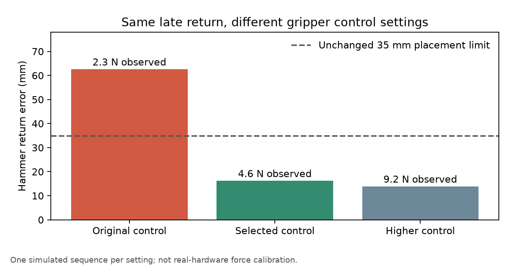

# Conversation while the arm works — October 11, 2026

This is a verified simulation milestone, not completion of the full workbench goal.
The baseline rejected requests while busy and discarded recorded speech other than
Stop. The new interface accepts questions and explicit changes during movement.

## What works

- “What are you doing?” reads the current task and phase without changing the
  original job, gripper command, manipulation path or task status.
- “Actually bring me the wrench instead” cancels the original task, returns the
  held tool, verifies rack placement, then starts the new pickup. An occupied
  handoff tray is also cleared before delivering another tool.
- Stop and resume preserve both stages of a tool change. Original cancelled
  records remain cancelled; recovery creates a new task.
- “Don't stop” preserves movement. “Don't bring me the hammer” withdraws the
  matching request and returns that tool, including after delivery has finished.
  Ambiguous model-generated Stop is a clarification, not permission to cancel.
- The general local model can answer during movement. A clarification asked
  during work survives completion of the original task; “Wrench” then selects
  the new tool. Reset clears that context and invalidates pending interpretations.
- Gestures are suppressed during manipulation; idle social gestures remain.
  A pending recognized request is retained when work finishes during recognition.

The original task manager, message broker and MCP interfaces remain in use.
The additional `/interact` route coordinates dialogue and changes; `/understand`
interprets against a snapshot without actuating. Stop invalidates delayed results
before they can submit another task. Local model generation is serialized.
A change arriving before the original worker claims a queued request cancels
that original as well; it cannot silently leave both tool requests queued.

## Observed evidence

The final saved-speech verifier exercises actual local ASR, the original bus and
native MuJoCo contacts. It does not emulate physics or move object poses.
`interaction-integration-004` passed the complete journey, including general model
conversation, withdrawn request and clarification across task completion.

| Observed result | Measurement |
| --- | ---: |
| Screwdriver rack placement during stopped/resumed change | 6.25 mm error |
| Wrench handoff after that change | 7.16 mm error |
| Wrench return | 4.60 mm error |
| Hammer return after withdrawing request during movement | 13.27 mm error |
| Clarification across completion: screwdriver return / wrench handoff | 11.39 / 7.13 mm error |
| Spoken Stop: last voiced sample to Stop POST | 519 ms |
| Stop: maximum settled joint drift over subsequent 600 ms | 0.00173 rad |
| Operational question: recognition plus dialogue dispatch | 152 ms |
| First general-model joke during motion | 6.01 seconds |
| Clarification / contextual choice interpretation | 1.76 / 1.68 seconds |

Question/dispatch timings start at submission of a complete saved recording; they
exclude capturing speech and detecting its end. Stop includes the shipped pause
detector and real-time waveform. Its 928 ms onset-to-POST measurement is separate
from the 519 ms end-to-POST measurement. Settling is measured separately.
The first recognition in this fresh session took 1.269 seconds; subsequent clips
took 115–144 ms. These are individual observations, not a latency distribution.

`interaction-evidence.json` preserves the results and measurements without audio.
The identical 30-trial replay passed all decisions. Common requests (18) had a
1.190-second median and 1.215-second p95; all trials had a 1.204-second median
and 2.907-second p95. This replay followed other speech tests and used already
loaded/warmed models: it is not evidence that startup's first request is faster.
The prior common median was 1.174 seconds; familiar decisions remain about as
fast despite the added interaction machinery. Six general trials had a
2.066-second median and 4.198-second p95; six guard trials had a 2.047-second
median and 2.855-second p95. The original end-of-speech boundary is unchanged.
135 lab tests, 118 exported fork tests, upstream hash checks, Ruff and shipped
JavaScript capture probes passed. Tests include all six ordered tool pairs,
deliberately failed grasp force, Stop racing delayed interpretation, and three
late hammer returns after other skills. Placement requirements remain: under
35 mm horizontal error, under 40 mm body height and under 30 mm/s speed.

## Failures changed the implementation

Different preceding skills can leave a poor inverse-kinematics branch. An empty
gripper now takes a bounded elevated ready-pose transit before a fresh grasp;
held-tool redirection never opens the fingers for that transit. Placement uses
the observed grasp offset and geometry-derived clearance for tilted tools.
These observations are privileged simulator data, not camera estimates.

The extended integration then found a hammer return missing its rack by 64.6 mm.
It correctly reported failure. Isolated late-return probes reproduced the slip.
Feedback descent regressed 32 protected checks; broad Cartesian carrying regressed
7; extra release clearance regressed 6. A narrower Cartesian hammer path passed
the existing tests but failed the new late-return probe. Eliminating an extra
lift improved that probe only to 47.4 mm and regressed a failed-grasp check.
A bounded regrasp proposal declined recovery when the scene was not clear enough.
All of these motion/recovery experiments were rolled back, not accepted as fixes.

The changed hypothesis was inadequate grip rather than waypoint accuracy. The
original positional gripper servo produced about 2.3 N of simulated actuator
force in these handles. In the
same late-return sequence, doubled stiffness with proportionally scaled damping
produced about 4.6 N and a 16.2 mm hammer return; quadrupled stiffness produced
about 9.2 N and 13.9 mm error. We selected the smaller change. The gap mapping,
original 100 N actuator cap, tool masses/friction, gravity and success thresholds
are unchanged. Vendor assets are unchanged. This is an explicit simulation
control setting, not a measured force setting for future hardware.

A separate short-audio failure rejected an unpadded 0.6995-second spoken Stop.
The recognition-only decoder now appends 350 ms of silence to recordings under
one second; this adds no capture wait, keeps the original audio duration and does
not relax speech-confidence checks. The same unpadded Stop fixture then passed.
The final Stop timing replay uses the original longer saved fixture for a fair
comparison; the complete interaction verifier independently uses short clips.

Retained local evidence: `runs/hammer-return-probe-001` through `006`,
`runs/grip-control-probe-001`, `runs/short-stop-probe-001`, and the fork extension's
`runs/interaction-integration-001` through `004`. Raw logs/audio remain local.
The first Stop replay directory has no completed verifier result and is not
counted as a pass; the second replay completed successfully.

## Limits and next work

The interface says **Listen while working**. Listening is still limited to active
work, visibly controllable, and disabled when idle. No wake word or persistent
idle microphone was added. The echo filter compares recognized text against a
recent spoken reply; it is not acoustic echo cancellation. Short Stop bypasses
that filter. A user's own voice, overlapping speech, noise and long internal
pauses remain live evaluation work. Do not infer room performance from saved
synthetic speech.

The full goal remains active. General model responses still take seconds and
can be much slower after long idle periods. Next: isolate prompt processing and
generation latency and compare a bounded optimization against conversational
correctness. Then continue varied-layout recovery, camera perception evaluated
against simulator truth, measured learning improvements and a hardware adapter
plan. Real robot operation and purchases remain separate decisions.
