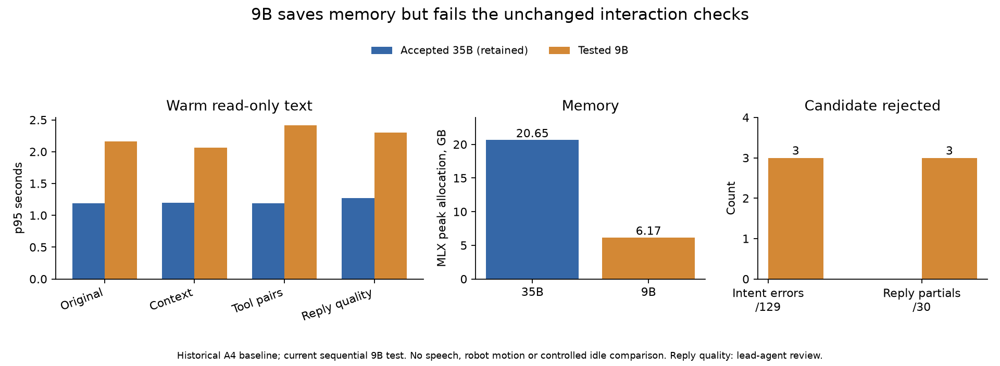

# Mid-sized model comparison — October 11, 2026

**Reject the 9B candidate as the default.** It makes three incorrect decisions
across the unchanged 129 native trials and has three incomplete replies under
the published reply-review criteria. The accepted 35B assistant is restored,
with language and speech input Ready. No working dependency or prompt changed.

## Actual comparison

The candidate is the existing Qwen3.5-9B MLX 4-bit conversion at revision
`938d8919941c6e7efd3c7150eff7fe9d12afa631`. Its two downloaded Safetensors files
match the pinned publisher's sizes and SHA256 hashes. Model identity and hashes
are retained in `mid-model-evidence.json`. The text backend strips vision weights;
this study does not enable camera interpretation or a manipulation policy.

The original large runtime was confirmed live and idle, then gracefully stopped
before loading the candidate alone. The exact unchanged simulator, accepted
prompt, parser, greedy sampler and prefix cache were used. Four frozen fixtures
ran through `/understand`, which does not create robot jobs, speech or capture.
Initial/final job identity remains unchanged in each run.

| Warm native text, median / p95 seconds | Accepted large, retained A4 | Tested 9B | 9B intent errors |
|---|---:|---:|---:|
| Original, 45 | 0.942 / 1.189 | 1.642 / 2.162 | 2 |
| Context, 18 | 0.965 / 1.197 | 1.582 / 2.061 | 0 |
| Tool pairs, 36 | 0.918 / 1.189 | 1.824 / 2.417 | 1 |
| Reply-quality schema, 30 | 1.026 / 1.273 | 1.861 / 2.304 | 0 |

The large rows are retained historical results on the exact same fixture hashes,
not a new randomized or matched-idle pair. Simulator observation strings can
vary as physics settles. Do not attribute every difference solely to model size.
The candidate is nevertheless slower on these warm trials and fails necessary
correctness checks. MLX process peak allocation is 6.166 GB versus the previously
observed large-model 20.654 GB, about 70% lower; this is not whole-machine RAM use.

Two repeated requests for a tool to drive nails yield answer/null rather than
fetch/hammer. The replies falsely say a hammer is unavailable despite the scene's
hammer. A two-tool negation selects Stop in one repeat, instead of the expected
bounded refusal/clarification response. All decisions are read-only: no incorrect
move or Stop was executed. Retain these failures rather than patch the fixture.

Reading all 30 actual replies gives 27 complete and three partial: two capability
replies omit simulation, and one camera denial describes knowledge from its
position in simulation rather than simulator-provided positions. All three false
success demands are denied without fetching a tool and pass their frozen review
criterion. This is lead-agent review, not a human quality verdict.



Saved-speech and physical promotion checks were not run for the rejected candidate:
the required native correctness gate already fails. Startup, controlled idle,
audible latency and room-noise performance are not established for 9B. The
candidate's small weight file alone does not demonstrate a responsiveness fix.

Reproduce only with sequential model runs, preserving the accepted public app:

```sh
python scripts/benchmark_dialogue.py runs/mid-original-new --fixture fixtures/dialogue_cases.json
python scripts/benchmark_dialogue.py runs/mid-context-new --fixture fixtures/dialogue_context_cases.json
python scripts/benchmark_dialogue.py runs/mid-pairs-new --fixture fixtures/dialogue_pair_cases.json
python scripts/benchmark_dialogue.py runs/mid-quality-new --fixture fixtures/dialogue_quality_cases.json
```

## Residency investigation

Installed MLX is 0.32.3 and MLX-LM is 0.32.0. The installed native library lacks
the `MLX_METAL_RESIDENCY_REFRESH_INTERVAL_MS` feature. MLX-LM temporarily wires
memory for generation and restores the previous limit afterward. The published
MLX issue and its maintainer's merged fix describe residency dropping during
GPU idle, consistent with our 27-second observation but not proof of its cause.
[Issue](https://github.com/ml-explore/mlx/issues/4609),
[maintainer fix](https://github.com/ml-explore/mlx/pull/4633).

Inspected the exact upstream merge `a59cc23190f1e26fabcba8693607bb4c34b2ac2b`
in a separate checkout and prepared a separate build environment. First build
failed because CMake was not on PATH; correcting that reached compilation.
With CUDA explicitly OFF, Metal ON and the documented JIT option ON, compilation
still needs `xcrun metal` for non-JIT kernels. The installed CommandLineTools SDK
27.0 lacks that tool. No patched wheel was built or installed. Both logs and
the isolated source/build environment remain local; do not repeat the build
without a changed capability or hypothesis.

The bounded probe uses installed supported MLX APIs and a temporary 1 GiB array.
After 12 seconds idle, first sums take 49.337 ms with no maintenance, 15.807 ms
with one-second tiny GPU work, and 46.369 ms with three-second work. Subsequent
sums take 9.0–10.6 ms. Minimum global wired memory is about 2.915/3.950/2.958 GiB
respectively, consistent with one-second work retaining this array. Order is fixed,
there is one trial per setting, and this does not isolate other machine activity.
The previous process limit is restored; no system setting changes. This is only
a mechanism check, retained in `residency-mechanism-evidence.json`, and still needs
actual model latency, resource cost, request priority and correctness before
changing the assistant. No macOS settings, CUDA, microphone scope or hardware
operation are involved. The full goal remains active; the RTX policy experiment
still awaits the existing workstation connection.
