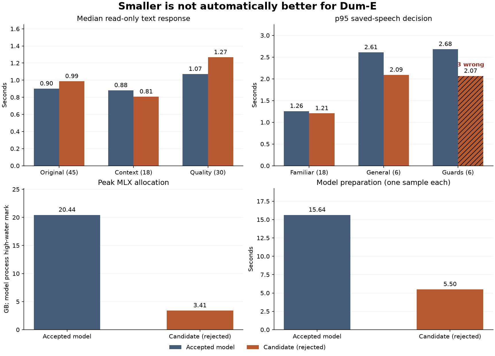
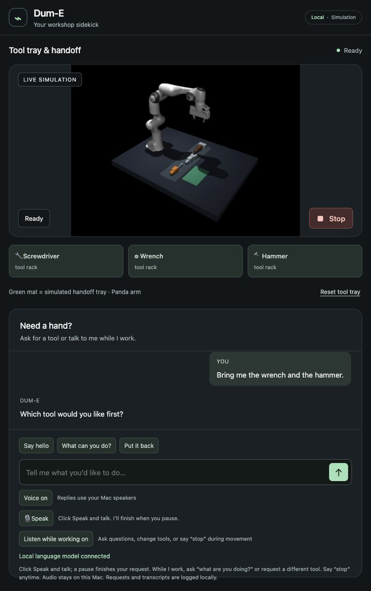

# Smaller model comparison — October 11, 2026

The smaller candidate is **not accepted as the default**. It saves substantial
memory and shortens some contextual decisions, but the actual speech workflow
revealed three incorrect tool selections. The accepted model is restored.
The broad workbench goal remains active; camera perception, measured learning,
hardware adaptation and the user live demonstration are still open.

## Candidate and comparison boundary

We compared the existing Qwen3.6-35B-A3B-4bit with
[Qwen3.5-4B](https://huggingface.co/Qwen/Qwen3.5-4B), using the
[MLX community conversion](https://huggingface.co/mlx-community/Qwen3.5-4B-MLX-4bit).
The publisher describes a 4B language model with a vision encoder and an Apache
2.0 license. Our installed text backend strips vision weights; this experiment
does not enable camera perception. The converted revision is pinned to
`32f3e8ecf65426fc3306969496342d504bfa13f3`. Its weight file is 3,034,300,695 bytes,
SHA256 `5fb9acd0246866381cf8c5c354c6db1019f6498eec4ccb4f5edcc71ffeacb2db`.
No new dependency, custom remote code, paid service or microphone access was used.

Both model runs start a fresh, identical simulator with the same accepted prompt,
prefix caching, sampler, token limit, ordered speech preparation and dependencies.
Only `WORKBENCH_MODEL` changes. The test order is original text, contextual text,
reply quality, then the current UI speech route. Runs are sequential, not competing
for the GPU. Live listening and speaker output were disabled through the browser
during automated tests. The model download completed before this matched pair.
The OS file cache was not purged and model order was not randomized; startup
samples are individual observations, not a cold-start latency distribution.

The original 15 text cases and six mixed-history cases remain unchanged, with
three repeats each. Ten additional reply-quality cases were written before
candidate testing, covering abilities, camera/feelings/hardware truthfulness,
tool information, chat, memory, false success and unsupported repair. Their hash is
`823f8ca3c50f1244239326454052f7a60dd92b92adf91f1a058b63b352ad0e8f`.
Reading their actual messages supplements the action/schema checks. These are
lead-agent reviews against explicit criteria, not independent human approval.

The same 30 saved waveforms drive the shipped pause detector, real local ASR and
current `/interact` endpoint for both models. Timing begins at the last voiced
40ms sample and ends at the decision observation. Conversation uses the API reply;
physical intent uses 40ms native polling. Neither audible onset nor completed
placement is included. The speech benchmark resets physical state between cases
while retaining dialogue history, as in the existing judge.

## Results

| Read-only text, seconds median / p95 | Accepted model | Candidate | Intent/schema mismatches |
| --- | ---: | ---: | ---: |
| Original, 45 requests | 0.900 / 1.187 | 0.986 / 1.318 | 0 / 0 |
| Mixed history, 18 requests | 0.881 / 1.247 | 0.807 / 1.023 | 0 / 0 |
| Reply-quality set, 30 requests | 1.071 / 1.571 | 1.267 / 1.557 | 0 / 0 |

The candidate reads the remaining prompt faster, but takes longer to generate
many replies. On the original cases, median first-token latency is 0.398 versus
0.278 seconds, while median generation time is 0.486 versus 0.693 seconds.
Some candidate replies are longer, such as asking what to do instead of a negated
request. A smaller weight file does not guarantee a faster complete reply.

| Current UI saved speech, seconds median / p95 | Accepted model | Candidate | Incorrect decisions |
| --- | ---: | ---: | ---: |
| Familiar commands, 18 | 1.172 / 1.257 | 1.162 / 1.205 | 0 / 0 |
| General wording, 6 | 1.743 / 2.609 | 1.552 / 2.091 | 0 / 0 |
| Guard cases, 6 | 1.740 / 2.683 | 1.552 / 2.065 | 0 / **3** |
| All 30 | 1.172 / 2.655 | 1.162 / 2.065 | 0 / **3** |

All three candidate failures recognized the exact spoken sentence
“Bring me the wrench and the hammer.” The model selected fetch/wrench rather than
asking which single tool to bring. That enters a physical task incorrectly; a
faster incorrect decision is not an improvement. The replay cancels each request
after observing its intent, so this is not evidence of completed delivery.

The native multiple-tool case used screwdriver and hammer, and supplied history
also differs from the speech workflow. These differences explain why the native
test cannot establish workflow correctness, but their individual causal effects
have not yet been isolated. Do not describe this as proven to be only a history
problem or only a tool-pair problem.

Manual quality review found 27 passes and three partial abilities replies for
the accepted model: they omit conversation. The candidate had 24 passes and six
partials: its abilities replies omit conversation/simulation, and its webcam
answers deny camera access but refer to sensed tool positions without naming
simulator truth. Neither model fabricated the requested hammer success or real
hardware control. The criteria and actual messages remain in the evidence.

Peak MLX process allocation fell from 20.441 to 3.415 GB, about 83%. Model
preparation took 15.638 versus 5.502 seconds; speech preparation 1.183 versus
0.986 seconds. These are observed startup samples. MLX peak allocation is a
process lifetime high-water mark, not whole-machine RAM use. The current app
still has the accepted model's larger memory requirement.



## Decision, evidence and next action

Keep the accepted default. The unchanged 30-case current-UI judge rejects the
candidate even though all 93 native requests passed. No prompt, parser expectation
or physical threshold was relaxed to admit it. No candidate physical recovery or
pending-answer Stop demonstration is claimed: it did not reach that acceptance
gate. Existing accepted-model physical/Stop evidence remains in dialogue-audit.md.

After restoration, a real browser capabilities exchange followed by the same
wrench-and-hammer request produces “Which tool would you like first?” The native
job remains null, no physical task is created and maximum measured tool drift is
1.65e-8 m. This is typed browser evidence, not a live speech demonstration. The
tray reset clears pending clarification; voice output and active-work listening
are restored. The app is left Ready with all tools at their racks.



The first preliminary accepted-model quality run recorded a 14.53-second first
response while download was active. That confounded sample is retained locally
and excluded from this matched comparison. Xet's weight output initially remained
zero bytes; a bounded range probe and the confirmed live process showed it was
not terminal. It completed after 258.45 seconds without restart, and its checksum
matched. This was an observed wait, not an application or GPU failure.

`model-comparison-evidence.json` contains public synthetic cases, actual replies,
manual verdicts, failed speech decisions, fixed hashes and startup profiles.
Raw runs and weights remain ignored locally. The benchmark now records HTTP
schema/intent errors as failed rows rather than losing the remainder of a run.
Original Dum-E source, locked dependencies and runtime code are unchanged.
Ruff, figure regeneration, both export-copy regression tests and source/fixture
byte-parity checks pass. Every pinned original Dum-E source hash still matches.
The existing 141 lab/122 fork suite results belong to the accepted A2 runtime;
they are not used to claim that this rejected candidate passed physical recovery.

Next, isolate the observed ambiguity using every pair of supported tools with
realistic prior dialogue, and improve explicit capability/concise-response
instructions before any new default decision. The already downloaded candidate
is sufficient for that investigation. Broader camera/learning/hardware work and
live room/noise/overlap measurements remain part of the goal.

From the lab, the native comparisons use:

```sh
uv run --locked python scripts/benchmark_dialogue.py runs/new-original
uv run --locked python scripts/benchmark_dialogue.py runs/new-context --fixture fixtures/dialogue_context_cases.json
uv run --locked python scripts/benchmark_dialogue.py runs/new-quality --fixture fixtures/dialogue_quality_cases.json
node scripts/benchmark_responsiveness.mjs runs/new-speech runs/responsiveness-fixtures-001 --frontend
uv run --locked python scripts/plot_model_comparison.py
```

All output directories must be new.
Plot regeneration uses the lab's existing locked Matplotlib dependency; it is not
required by the fork simulator. The exported plot source is provided for use in
an environment with Matplotlib, without adding it to the fork runtime.

The candidate can be reproduced by downloading
the pinned conversion's JSON, Jinja, Safetensors and README files into a local
folder with `huggingface_hub.snapshot_download`, then setting `WORKBENCH_MODEL`
to that folder for `uv run --locked dume-sim` in the fork extension. Keep the
accepted default when not testing. Do not run competing manipulation verifiers
or export during verification. The source manifest records every downloaded hash.
