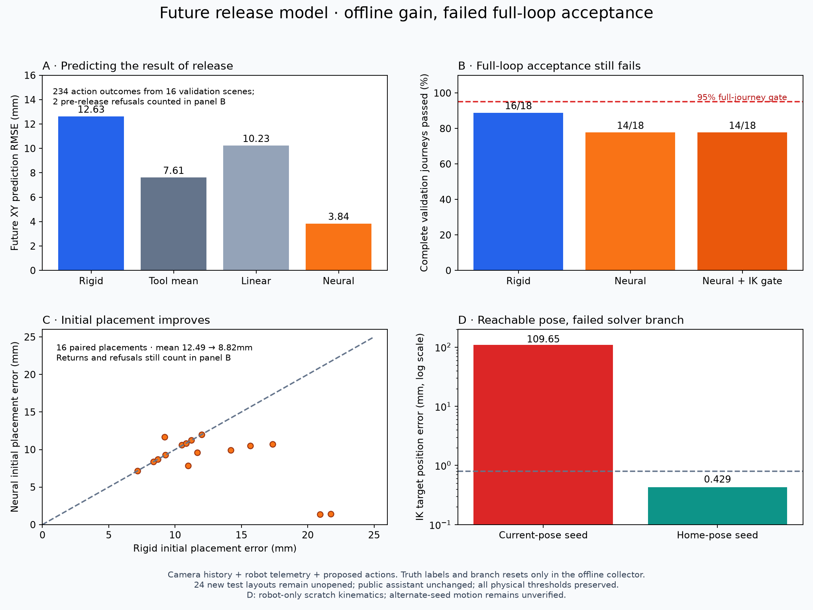

# Future physical outcome model — experimental D2c

We now predict where a tool will settle after a proposed lowering/release action.
The neural ensemble passes its offline validation judge and improves initial
placement, but **complete journeys get worse: 16/18 rigid versus 14/18 learned**.
It remains experimental and is not enabled in the working assistant. The full
workbench goal remains active.



Knowing where a held tool is now was insufficient in D2b. This model predicts
the result of contact, opening and withdrawal. That is a small action-conditioned
world model over one skill. It is neither a video model nor a general simulator
of the workbench. Better first placement still fails to guarantee a good next
grasp and return.

## Inputs, actions and independent judging

The model receives 76 values from camera history and robot measurements: tool
identity, camera heading and its known/unknown flag, yaw modulo 180 degrees,
inferred grasp offset, grasp/current joint/TCP pose, rotation, finger gap, time,
velocities, actuator loads, requested destination, nominal release point,
historical scene estimates and proposed XY offset. Missing observations stay
explicitly unknown; no true-pose or nominal-rack fallback fills them. Historical
scene estimates are not a live held-tool measurement. Panda torque and ideal
gripper gap remain simulator proxies needing real sensing/calibration later.

There are nine bounded offsets from the ±20mm/zero XY grid. Each predictor learns
a final residual relative to that proposed translation and also predicts resting
height, speed and added neighbor movement. Height/speed/disturbance outputs are
clipped nonnegative. The actor checks supported inputs, provisional ensemble
disagreement, predicted physical limits and robot kinematic feasibility. These
are not calibrated safety guarantees or collision-free path proof. It only
reports `released_unverified`; independent physics still owns success.

The actor has narrow camera/robot ports and no object-state, segmentation-ID or
support-geometry access. The offline collector snapshots the same observed grasp
and tries actual contact/gravity/release physics for each proposed action.
**Snapshot resets and privileged labels stay in the collector**. They do not enter
runtime features or full-journey tests; no tool is welded or teleported during a
judged journey. Zero-action replay matches both normal continuation and repeated
replay exactly across all 138 collected release states.

## Frozen experiments and measured results

Before fitting we froze 72 training, 18 validation and 24 test layouts, balanced
by tool and delivery/resume/redirect, with shuffled slots, yaw, position and light.
All branches and both legs of a scene stay in one split. The collector excludes
every test scene. It records 1,242 physical action outcomes: 1,008 training rows
from 67 attempted training scenes and 234 validation rows from 16 attempted
validation scenes. Five training and two validation pre-release failures remain
in the records and full-journey checks. Collection does not establish coverage of
all conditions.

Three fixed-seed members each use two 64-unit ReLU layers and 9,413 parameters.
CPU Torch 2.14.1 fits them for 300 epochs with Adam at 0.003 and batch size 128.
Tool-mean and ridge-linear baselines use the same episodes/labels. The first fit
takes 1.821s and predicts covered future XY with RMSE 4.523mm/p95 8.417mm, but
refuses nine actions for one genuinely unknown-heading validation state. Every
training heading-known flag was 1; the missing cue produced normalized 100.

We change the data hypothesis once: duplicate training rows with signed-heading
cos/sin/known channels withheld. This sensor-dropout augmentation does not invent
a direction, widen a runtime bound, alter labels or augment validation/test rows.
The second fit uses 2,016 rows from the same 67 scenes and takes 3.072s. No third
fit occurs. NumPy predictions agree with independent Torch arithmetic within
5.51e-9 in output units across all 234 validation actions (numeric limit 1e-6).

| Predictor | Future XY RMSE | p95 error | Validation rows withheld |
|---|---:|---:|---:|
| Action translation / rigid baseline | 12.631mm | — | 0 |
| Learned tool mean | 7.614mm | 13.634mm | 0 |
| Learned linear | 10.232mm | 13.320mm | 0 |
| Neural ensemble with sensor dropout | 3.842mm | 7.905mm | 0 |

Recorded-state neural action selection has full coverage and improves actual
selected placement by 3.676mm on average against zero offset. It passes the
frozen future-position p95 below 10mm, batch-nine inference below 10ms, recorded-
state coverage and positive-gain checks. These provisional bounds belong to a
different *future-outcome* task; they do not relabel D2b's failed current-position
model as passing.

Standalone nine-action NumPy inference measures 0.071ms median/0.088ms p95 across
100 sequential batches, first sample 0.132ms. Small batch contractions avoid the
earlier vector/BLAS overhead; this is not an equal comparison with D2b's different
model/kernel. Actual successful decisions including features and candidate IK
measure 5.17ms median/11.55ms p95. Camera, speech and motion are excluded. No new
live voice latency claim is made; neural calculation is not the main bottleneck.

Full physical validation remains worse. Rigid passes 16/18 full journeys; neural
passes 14/18, before and after the bounded IK-candidate check. All 16 initially
achievable placements pass the original 35mm limit; their average error improves
from 12.491mm to 8.825mm. Two subsequent returns fail. The shared two initial
weak-fit refusals still count. Limits stay 80mm lift, 35mm placement, 40mm resting
height, 30mm/s speed, 4mm other-tool movement, 608ms Stop with grip retained and
joint drift below 0.03rad, and **95% full-journey acceptance**. Both policies fail.

## Diagnoses and next work

Validation-000's first placement changes its next grasp. At the return decision,
wrist actuator load is −12Nm versus training mean −0.107Nm and scale 1.129Nm:
normalized 10.535, outside the unchanged bound of 8. The actor holds. This is
actuator saturation; its precise contact/servo cause remains unknown. Tracking
and contact diagnostics are needed rather than simply widening a model guard.

Validation-014's current-seeded solver rejects all nine return descents. A separate
robot-only scratch diagnostic reaches the zero-offset target from the home seed
with 0.429mm position error and 0.000259rad orientation error. The current seed
ends at 109.645mm error after 120 iterations; several other seeds also converge.
**The pose is reachable; the single-start optimizer fails.** Alternate seeds are
not yet an adopted, collision-free physical motion policy.

After two fits and two physical policies, replan toward verified motion tracking,
bounded IK recovery and camera viewpoint recovery before further fitting or public
integration. **All 24 new test layouts remain unopened** because full-loop
validation fails. Existing D2/D2b cases remain regressions. All-phase camera
recovery, useful full-journey model gains, camera-informed public operation, live/
noise/audible/cold responsiveness, hardware preparation and the required human
demonstration remain open. Accepted A4 continues in the public app.

## Reproduce and retain

Use fresh output folders. Collect/fit in the lab's locked Torch environment:

```sh
uv run --locked python scripts/collect_release_data.py runs/release-data-new
uv run --locked python scripts/train_release_model.py runs/release-data-new \
  runs/release-fit-new --sensor-dropout fixtures/release_sensor_dropout.json
```

The lightweight fork can run NumPy inference and physics without Torch:

```sh
uv run --locked python scripts/verify_camera_delivery.py runs/release-rigid-new \
  --fixture fixtures/release_model_cases.json --split validation --return-after-delivery
uv run --locked python scripts/verify_camera_delivery.py runs/release-neural-new \
  --fixture fixtures/release_model_cases.json --split validation --return-after-delivery \
  --release-model src/physical_ai_lab/assistant/assets/learned/release-outcome-v2-experimental.npz \
  --release-kind ensemble
```

Fixture SHA256: `7fda988b669f9ccd79e73ca469c499126e6fe5939ce351f20f4807fc47108197`.
Dataset: `56bd2ebd8ba151727786cdc42d3ff8a2aaf274a6d1180aa62843664d44de71e7`.
Checkpoint: `0f8ed20dce5f72cdcd0ba5a2a9a7f163ccb110ca3e264499672db708b722dacb`.
Dropout protocol: `d3145ee342f9ea6a36fb6eadd57017f66d3fd40eb3bcd291055b81c30fd68b01`.

Full lab regression: 165 tests pass. Four focused checks cover units, numerical
refusal, explicit unknown heading, selection without simulator truth and exclusion
of an unreachable best prediction. One new analytic exact-zero standard-deviation
assertion failed on 3.47e-18 roundoff; numerical tolerance became 1e-15 with all
physical judges untouched. The exported fork independently passes 146 tests; Ruff/format pass for 85 lab
and 61 fork Python files, and all 46 pinned upstream hashes match.
Raw branch snapshots/logs stay local; the experimental checkpoint, fixed fixtures
and [measured evidence](release-learning-evidence.json) are retained.
