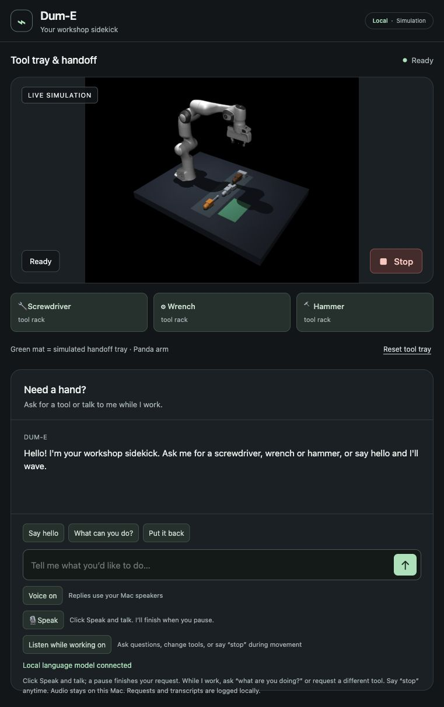

# Keeping the accepted model responsive while idle

The accepted Qwen model, prompt and physics remain unchanged. Supported macOS
hosts now automatically use process-local memory maintenance when allocations
fit the device's recommended budget. It retains a bounded MLX residency limit
and evaluates a tiny independent scalar operation approximately once per second
only when the language worker is idle. It does not decode text, record audio,
alter conversation history or create robot commands.

This follows the mechanism observed in the installed MLX API experiment after
the official framework build was blocked by the missing Metal compiler. No
macOS setting, CUDA package, working dependency or robot hardware was changed.
The maintained framework fix remains the preferred future replacement when a
compatible released/buildable version is available.
[MLX residency API](https://ml-explore.github.io/mlx/build/html/python/_autosummary/mlx.core.set_wired_limit.html),
[upstream fix](https://github.com/ml-explore/mlx/pull/4633).

## Actual results

| Real native text after ~12.3 seconds idle, 3 trials | Maintenance off | Maintenance on |
|---|---:|---:|
| Median | 1.434 s | 1.144 s |
| p95 (the maximum of only 3 samples) | 1.475 s | 1.153 s |

A single **120.262-second** idle trial with maintenance answers correctly in
**1.134 seconds**, first token 406 ms. Fixed order, uncontrolled OS caches and
small sample sizes limit interpretation. Neither study matches the earlier
unknown natural idle duration that produced a 27-second response. Do not claim
that hours of idle, sleep/wake or deliberate memory stress are solved.

All **129 frozen native decisions** pass. Reading the 30 actual quality replies
finds complete answers within their case contexts; this is lead-agent review,
not human approval. The last physical-hardware denial's “real-time control”
phrase is interpreted in that hardware context, not as a claim about the running
simulator. Early native trials overlap lab regression checks, so their timings
are not a clean isolated causal comparison.

The primary speech comparison reuses the actual retained waveform directory
after other checks finish. An earlier pilot accidentally generated a different
directory and overlapped early fork tests; it is retained and labeled separately.
No live microphone or speakers were enabled during either automated run.

| Saved speech, end-of-voice → decision median / p95 | Retained A4 before | Maintenance on |
|---|---:|---:|
| Familiar commands, 18 | 1.174 / 1.247 s | 1.162 / 1.194 s |
| General wording, 6 | 1.688 / 2.341 s | 1.562 / 2.044 s |
| Guards, 6 | 1.711 / 2.350 s | 1.569 / 2.054 s |

All 30 decisions pass. The before data is historical, not a new randomized
control. Timing uses the unchanged last voiced 40 ms sample to API/intent
observation; it excludes audible onset, completed delivery and live room noise.
General tails still exceed two seconds slightly. No target is relaxed.

Actual saved spoken Stop during a pending inference reaches Stop POST **588 ms**
after the final voiced sample. The late reply is superseded, the task cancelled,
the gripper command retained, and subsequent maximum joint drift is **0.000572 rad**.
The test verifies pending-reply cancellation and settled physics, not live acoustics.
Lab **186** and independently exported fork **167** tests pass; Ruff and format
checks pass. All upstream source and protected physics/model fixtures are retained.

## Tradeoff and controls

The measured requested process limit is approximately **18.50 GiB**; the mode can
keep substantial RAM resident instead of allowing idle compression. A tiny refresh
takes about 0.2–0.7 ms in sampled model profiles. Battery/power cost and behavior
under competing memory-heavy applications have not been measured. This mode is
bounded to the existing device recommendation, never raises an OS limit, and
restores the previous process limit during cleanup. Native process exit also
releases its allocations.

Queued requests take precedence over idle maintenance; it uses the model lock
nonblockingly and skips when another inference owns it. A refresh failure disables
maintenance and records the reason rather than killing the request worker.
Unsupported automatic setups fall back to ordinary inference with a logged
reason. The explicitly required mode fails setup if unsupported.

```sh
# Default: supported macOS 15+ with an adequate measured model budget
uv run --locked dume-sim
# Opt out of keeping idle memory resident
WORKBENCH_KEEP_MODEL_RESIDENT=0 uv run --locked dume-sim
# Require the mode for a controlled experiment (fail if unsupported)
WORKBENCH_KEEP_MODEL_RESIDENT=1 uv run --locked dume-sim
# In another terminal, with that Ready simulator:
python scripts/benchmark_idle_model.py runs/idle-new --idle-seconds 12 --repeat 3
```

Keep one runtime at a time; use a fresh log directory for each comparison. See
`residency-evidence.json` for all bounded results and the retained pilot. Full
camera manipulation, matched long-idle stress, live/audible interaction, the
pretrained RTX policy run and the human demonstration remain incomplete. The
full goal stays active.

The default launch was independently observed Ready with automatic maintenance
enabled and no fallback error. Voice and motion listening were restored, the
microphone is idle, and all three tools are on the rack.


