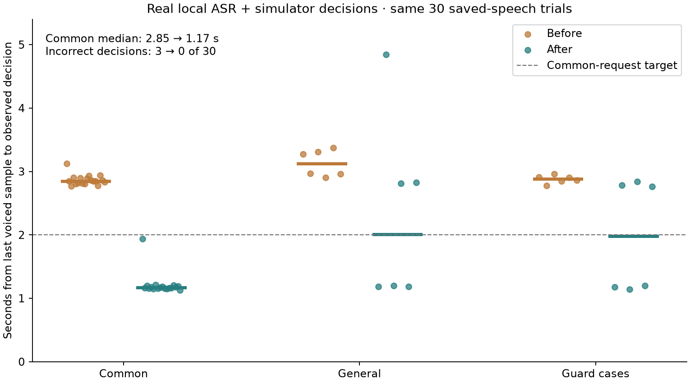
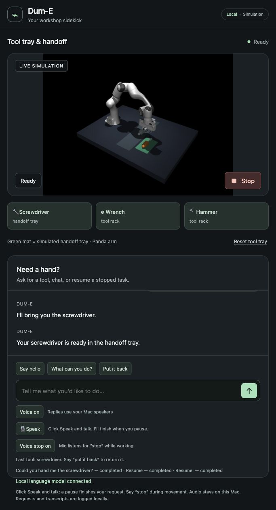

# Responsiveness experiment — October 11, 2026

The accepted workbench goal is active in `workbench-goal.md`. This is the first
measured improvement, not completion of the assistant.

## Result

| Last voiced sample → observed execution decision | Before median / p95 | After median / p95 |
|---|---:|---:|
| Common commands, 18 trials | 2.85 / 3.12 s | 1.17 / 1.94 s |
| All requests, 30 trials | 2.89 / 3.31 s | 1.18 / 2.84 s |
| General questions / semantic requests, 6 trials | 3.12 / 3.37 s | 2.01 / 4.84 s |

Incorrect decisions: 3/30 before, 0/30 after. The repeated negative request
“Don't bring me the wrench” incorrectly reused the preceding screwdriver request
in the baseline. Explicit complete negative requests now produce a non-physical
answer instead of letting old context select a tool.



## Changes and tradeoffs

- Whole-utterance routing handles familiar explicit fetch/return/greeting commands.
  It never selects a tool merely because its name occurs in a sentence. Negation,
  multiple tasks, conditions, quotations and semantic requests do not match the
  positive route. Complete supported negative requests have a separate decline route.
  Other wording still uses the existing local language model.
- Native per-job telemetry records request receipt, interpretation route, decision,
  pickup start and task completion. Stop invalidates pending commands as before.
- Removed the serial nod before and after manipulation. Five previous successful
  task traces spent 1.981–2.118 seconds acknowledging before approaching a tool.
  Delivery now starts immediately; greeting and conversational gestures remain.
  Actual contact/lift/release/final-placement checks are unchanged.
- Repeated Stop is idempotent. The bridge recognizes native cancellation even if
  it observes the stop epoch before the shared task record is marked cancelled.
  A replaced job without a stop phase still fails rather than claiming cancellation.

## Measurement boundaries

Thirty real-time saved-speech trials: ten utterances repeated three times. Exactly
the same audio files and case order were used before and after. The shipped
microphone controller samples the saved waveform every 40ms and detects its pause.
It submits actual audio to cached local Whisper, then recognized text through the
original Dum-E task bus. Native intent is observed with 40ms HTTP polling.

The endpoint excludes audible reply onset and physical task completion. The last
voiced sample is an energy-based approximation to the end of speech. These are
synthetic speech fixtures, not a test of the user's microphone or room noise.
Dialogue histories differ between running sessions. No pause threshold (900ms),
timing target, physical tolerance or failure criterion was loosened.
Medians average the two middle samples for even counts; p95 uses nearest rank.
The first harness reported the upper middle sample; the audited comparison corrects
that calculation using the original timings, which remain unchanged.

The first post-restart recognition took 952ms; its common-command decision still
arrived in 1.94 seconds. First semantic fallback took 3.72 seconds after submission
(4.84 seconds from end of speech). The initial probe after a long idle period took
37.05 seconds to interpret, was cancelled at the harness timeout, and its late
result was discarded. This failure is retained separately from the completed
warmed baseline. Loading-time and idle-after-sleep distributions remain unmeasured.

The provisional 2-second common decision target passes these 18 fixture trials.
This does not establish live voice performance, broad language correctness, room
noise robustness, or the acknowledgment target. General latency still needs work.

## Reproduction and evidence

With the simulator running, and browser speech/motion listening temporarily muted
to isolate fixtures from speaker feedback:

```sh
node scripts/benchmark_responsiveness.mjs runs/latency-new-001 runs/latency-fixtures-001
# Reuse the identical fixture directory after changing/restarting the implementation.
node scripts/benchmark_responsiveness.mjs runs/latency-new-002 runs/latency-fixtures-001
```

Restore voice and motion listening after tests. Fresh output directories preserve
failed runs. `scripts/report_responsiveness.py` produces the checked-in comparison
from the named lab runs. Raw trial summaries, transcripts, boundaries and the
cold-after-idle failure are retained in `responsiveness-evidence.json`.

Native integration evidence lives under the fork extension's
`runs/responsiveness-recovery-001` and `runs/responsiveness-stop-*`.
Saved speech verifies automatic completion, negative Stop rejection, cancellation,
settled joint drift, held-tool resume/return, physical placement and spoken expression.
The second Stop probe exposed a transient phase race; it is retained as a failure.
The judge now waits for actual Stopped before asserting settled cancellation;
the latency endpoint is unchanged.

Final saved-speech Stop: 518ms after the final voiced sample to the Stop request;
settled joint drift 0.0000343 rad. The final lab suite has 112 passing tests.
The standalone fork has 95 passing tests. An actual browser-button fetch completed
with a measured 9.52mm placement error. Native decision took 39.3ms after request
receipt; approach started at 41.2ms and verified completion at 15.53 seconds.
Voice and motion listening were restored after the isolated fixture tests.



Next work: interaction during movement and explicit task changes, broader language
and noise trials, smaller/faster general interpretation when justified, camera
perception and useful learning experiments. Human live demonstration remains required.
