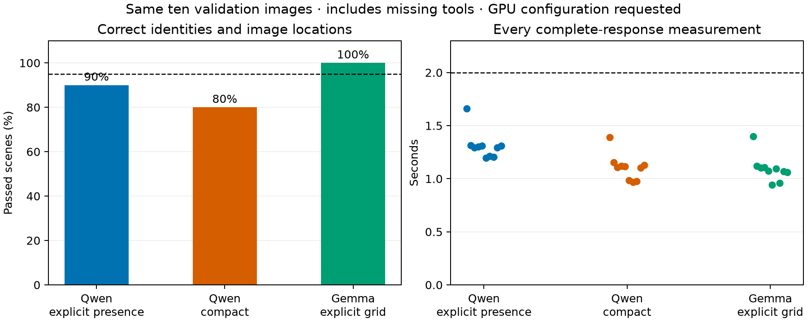
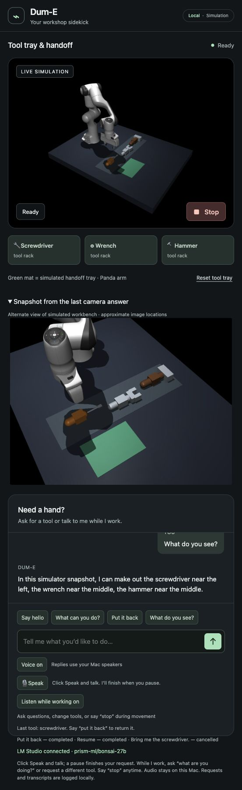

# Camera questions with existing models — October 12, 2026

The workbench can inspect a synthetic camera snapshot using a separate pretrained
vision model, while Bonsai handles conversation and the existing physical
controller handles motion. The selected Gemma 4 31B adapter passes all ten fixed
validation scenes, including reordered tools, missing tools, rotation and light
variation. No absent tool is invented. Image locations are conversational
estimates; these are not metric robot grasp targets.



## What changed

`What do you see?`, `What can you see on the workbench?`, and
`Where is the screwdriver in this image?` have a read-only path. The model gets
only JPEG pixels and a declared catalog of our three primitive tool shapes.
Current object coordinates, inventory, task history and evaluation labels are
not sent to it. Normal requests still use the existing conversation/fast-command
paths. A camera answer cannot submit motion, change grip or replace a running
task. Stop bypasses the vision lane and invalidates late replies.

The optical front and side cameras render the actual simulation without changing
physics, lighting, geometry or object poses. Both frames come from the same
physical state. A second view is inspected at most once when the first is
uncertain. The system chooses a complete observation from one view; it never
fills a missing class or coordinate from simulator object state. If uncertainty
remains, the answer says so. The displayed snapshot is the exact JPEG used for
that answer, verified by its hash. Old snapshot hashes are rejected.

The first integrated journey passed saved speech, camera conversation during
motion, pending-vision Stop, a 32-second physical hold, resume and return, but
failed its final all-tools-visible camera check. The returned screwdriver was
visible but shadowed, and the model declined to identify it. The snapshot and
failure are retained. After adding the side view, the **unchanged** journey
passes, including that final check. No physical or visual-success gate was
weakened, and no brightness trick or pose reset was used to conceal the failure.

## Model choice and responsiveness

All weights used here were already available in the user's LM Studio library;
no weights were downloaded. The preferred workstation remains authorized through
the existing LM Link connection. CLI peer/model metadata now verifies that
Bonsai and the selected vision instance are loaded on that linked workstation.
This verifies placement, not GPU utilization, driver version or kernel behavior.
[LM Link routing](https://lmstudio.ai/docs/developer/core/lmlink).

The selected visual model is the cached `google/gemma-4-31b`, Q 4_K_M, roughly
19.89 GB. Its explicitly selected workstation instance is
`workbench-vision-gemma`:4096-token context, one inference lane, GPU offload
requested at 100%. The loader's memory estimate was 20.22 GiB. Bonsai remains the
conversation instance. The two roles can use different models.
[Gemma model card](https://huggingface.co/google/gemma-4-31B-it),
[LM Studio load controls](https://lmstudio.ai/docs/cli/local-models/load).

The single-view validation takes 0.941–1.398 s from HTTP request to complete parsed
observation, with a 1.083 s median. It excludes image capture, speech and motion.
All ten scenes meet the unchanged 95% scene-accuracy, zero absent false-positive,
40-pixel conversational-location and 2-second model-response targets. The largest
location error is 10.53 pixels. These criteria do not replace the existing 5 mm
metric perception criterion for camera-controlled manipulation.

With bounded second-view recovery, all ten scene/position checks still pass,
with no absent false positives. One missing-tool case takes 2.126 s and misses the
2-second response target. The actual post-return recovery in the integrated
journey takes 2.225 s. This tail remains a responsiveness gap; it is not silently
counted as meeting the target. Normal model/physical decisions remain separate.

The candidate's saved-speech camera dispatch takes 1.473 s after transcription.
The camera question during motion takes 1.522 s and preserves the original job.
Typed Stop is observed in 63.96 ms while a real vision call is pending. The late
camera answer is superseded. A 32.04-wall-second hold retains the tool above
224.22 mm with maximum joint drift 0.00395 rad, then resume/return are physically
verified. These are separate clocks, not an end-of-live-speech or mechanical
settling claim.

## Failures that informed the implementation

- Bonsai accepts images but misses the toy wrench, then wrench/hammer after a
  catalog revision. Empty-scene controls pass. It was kept for conversation,
  not promoted as a reliable visual detector.
- The cached Gemma 12B pilot recognizes the full and empty scenes, but takes
  6.02–9.31 s on the Mac. CLI provenance distinguishes this from the workstation.
  The temporary local instance was unloaded.
- Qwen on the workstation takes 5.69–8.38 s with its initial load. Reloading with
  explicit full GPU offload/single-lane configuration brings the same pilot
  replies to 1.05–1.63 s. This is not an alternating causal GPU-only experiment.
  Its expanded/compact validation achieves 9/10 and 8/10 respectively and invents
  absent tools. Both protocols are rejected and the temporary model is unloaded.
- Gemma 31B's default workstation pilot is correct but takes 8.49–13.70 s.
  An explicit GPU configuration improves speed. Its compact output initially
  violates the declared normalized-coordinate contract. The original request
  remains rejected: we do not infer units automatically or clip coordinates.
  Retained output suggests a 0–1000 [y,x] convention. A new explicitly requested
  convention and strict conversion to normalized [x,y] passes the same pixel
  judge. This is an observed server/model behavior, not a universal claim about
  all Gemma builds. Both formats remain configurable.
- A CLI short key resolves to the local copy when duplicate model names exist;
  an indexed device prefix is not accepted by that command. Those loads were
  rejected before prediction and their owned local instances unloaded. The
  documented interactive selector explicitly identifies the workstation copy.
  REST routing after the preferred-device setting also verifies remote placement.
- Native-app inspection failed because the Mac was locked. Official CLI/API
  access remained usable. No credentials, link access or permissions were added.
- An initial export stopped on a missing figure script. Core/test files were
  copied atomically; no new runtime was launched. The script was added and the
  export completed with all 46 upstream hashes unchanged.

Some early rejected responses lacked raw-output capture; those cases remain
rejected and their latency is not reconstructed. The recorder now preserves
provider output before parsing so later failures are reviewable. Raw local
recordings and traces remain in ignored `runs/`; the public evidence is synthetic.

## Reproduce and next work

Load an already available vision model in LM Studio with a suitable memory
budget. When duplicate names exist, use the CLI selector and choose the intended
device rather than assuming a short key picks it:

```sh
lms load --gpu max --parallel 1 --context-length 4096 --identifier workbench-vision-gemma
```

For this qualified instance, launch from the lab root:

```sh
uv run --locked --extra assistant --extra dume dume-sim \
  --language-backend lmstudio --model prism-ml/bonsai-27b \
  --vision-model workbench-vision-gemma --vision-coordinates grid 1000_yx
```

The fork's `extensions/workbench` uses `uv run --locked dume-sim` with the same
arguments. `--vision-model` selects an exact server instance. Coordinates are
explicit (`normalized_xy` or `grid 1000_yx`); incompatible or substituted model
replies fail without robot commands or a paid fallback. The launcher rejects
reusing a native simulator with a different camera model, units or endpoint.
Camera questions are optional for portable Mac-only launches.

`scripts/benchmark_vision_language.py` preserves the fixture/prompt hashes,
JPEG inputs and independent segmentation labels. Its `--alternate` flag measures
the complete two-call recovery cost. `scripts/verify_camera_questions.py` checks
the actual saved-speech/task-bus/physics journey and retains failures.

This milestone supplies camera descriptions and a verified interruption path.
Camera-derived metric motion, pretrained arm-policy execution, real acoustic
robustness and the user's live demonstration remain incomplete. Simulator
success does not establish hardware readiness. Full objective remains active.

The final full suites pass 263 lab tests and 244 exported fork tests, with all 46
protected upstream files unchanged. The independently launched main app also
passes the same saved-speech/vision/physical journey:Stop 6.56 ms,32.10 s wall hold,
minimum height 225.30 mm, maximum joint drift 0.00463 rad, verified resume/return.
Its camera dispatch is 1.274 s, question during motion 1.738 s and post-return
second-view recovery 2.516 s. The last figure's single-view timings do not stand
in for this complete recovery cost.

Main 8766 is Ready on Bonsai with Gemma for camera questions, all tools on rack,
Voice/listen ON and microphone idle. The actual browser button returned a
read-only RGB-grounded answer without a physical job. The camera panel displays
the exact selected snapshot; the isolated candidate is shut down.

The narrow-window camera panel initially overlapped the conversation. A small
CSS correction makes the open panel expand; the actual rendered snapshot is
now visible. This style-only change was visually checked after the final suites.


